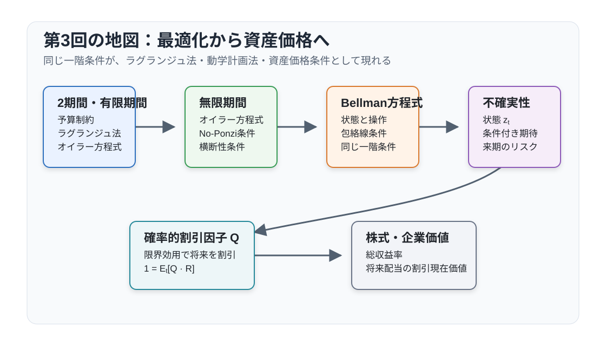
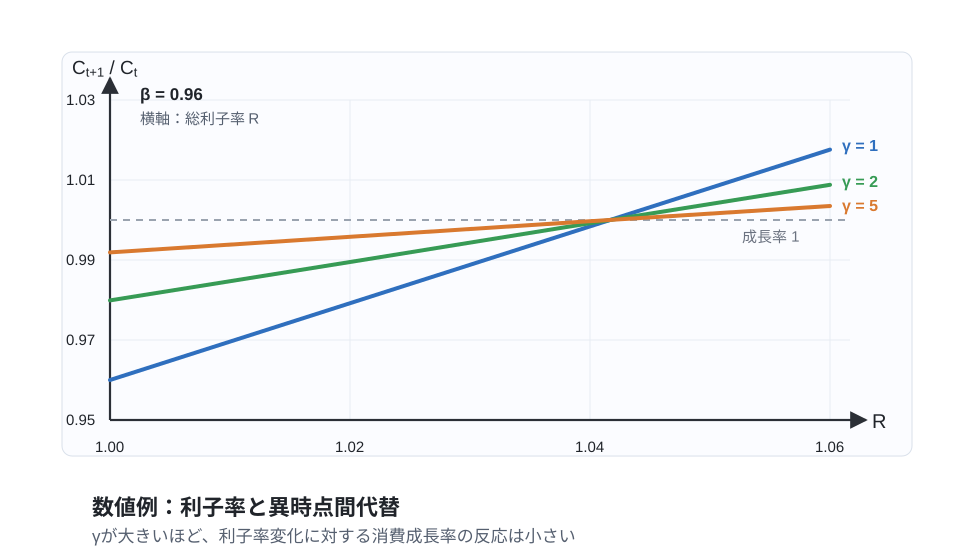
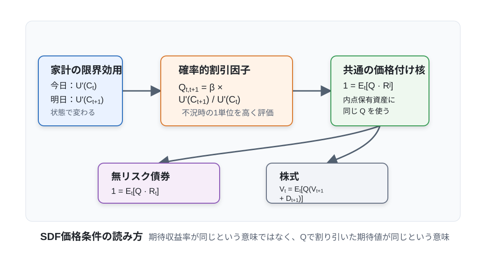

# 講義の目的

## 本講義で探究する中心的な問い

現代の動学マクロ経済学（DSGEモデル等）を学ぶうえで欠かせない中心的な基礎方程式は、以下の3つです。本講義では、これらの条件を自分で論理的に導出し、背後にある経済学的直観を分かりやすく説明できることを主な到達目標とします。
$$
\begin{aligned}
U_C(C_t) &= \beta R U_C(C_{t+1}),\\
1 &= \mathbb{E}_t \left[ \beta \frac{U_C(C_{t+1})}{U_C(C_t)} R^j_{t+1} \right],\\
V_t^F &= \mathbb{E}_t \left[ \beta \frac{U_C(C_{t+1})}{U_C(C_t)} \left( V_{t+1}^F + D_{t+1} \right) \right].
\end{aligned}
$$

- 第1式は、不確実性のない世界における**決定論的オイラー方程式**（Euler Equation）です。
- 第2式は、不確実性（ショック）が存在する経済における**資産価格付けの基本方程式**（確率的オイラー方程式）です。
- 第3式は、企業の生み出す配当流列から株式の市場価額を評価する**株式価値（配当割引）の決定式**です。

これら3本の式は複雑に見えるかもしれませんが、同じ経済学的原理に基づいています。当期の消費を限界的に1単位減らして貯蓄や投資に回す限界費用と、それによって将来追加的に得られる消費の限界便益の割引現在価値を等しくするという、異時点間の最適配分条件です。

本講義では、次の順に議論を進めます。

1. **有限期間モデルの解法**：2期間および有限期間の消費・貯蓄問題を、ラグランジュ未定乗数法で解く。
2. **無限期間への拡張**：計画期間を無限大に送る際に不可欠となる「No-Ponzi条件」と「横断性条件（TVC）」の役割を理解する。
3. **動学計画法（ダイナミック・プログラミング）の導入**：同じ動学的最適化問題を、Bellman方程式と包絡線定理で再帰的に解く方法を身につける。
4. **不確実性の導入とSDF**：経済に確率的ショックを導入し、期待値付きのオイラー方程式から「確率的割引因子（Stochastic Discount Factor: SDF）」を導出する。
5. **企業価値・株式価格への応用**：導出したSDFを用いて、株式や配当の価格付け理論へと統一的に拡張する。

最低限の到達目標は、オイラー方程式とSDFの定義式を正しく導出し、基本方程式 $1 = \mathbb{E}_t[Q_{t,t+1} R^j_{t+1}]$ が家計のポートフォリオ最適化を表すことを経済学的に説明できることです。第9節では、株式を含む家計問題から債券と株式の価格条件を導き、株式収益率と無裁定条件、配当割引モデルを学びます。これらの家計の一階条件を、第4回の均衡条件へつなげます。

初めて読むときは、有限期間から「確率的な横断性条件」までを読み、次に第9節の[株式を含む家計の最適化](#sec-equity-core)へ進んでください。予算制約、一階条件、株式収益率と無裁定条件、配当割引の順に確認し、[まとめと第4回への接続](#sec-lecture03-bridge)で均衡分析へのつながりを整理します。巻末の演習問題の問1〜問4は本編の範囲で解答できます。末尾の横断性条件の証明は、必要に応じて補論で確認してください。

@fig-lecture03-overview は、本講義の理論展開を図にまとめたものです。

{#fig-lecture03-overview width=95% fig-pos="H"}

# 表記と基本設定

決定論的な基本ケースでは、家計は期首に前期から引き継いだ資産残高 $B_{t-1}$ を保有し、当期の消費 $C_t$ と次期へ繰り越す資産 $B_t$ を決定します。実質総利子率を $R = 1+r$（$r$ は純利子率）とすると、フローの予算制約式は次のように書かれます。
$$
C_t + B_t = R B_{t-1} + Y_t.
$$
ここで右辺は「当期に利用可能な総資源（過去の元利合計＋当期所得）」を表し、左辺は「当期の資源の配分先（当期の消費＋次期への貯蓄）」を表しています。$B_t>0$ は貯蓄、$B_t<0$ は借入れを意味します。借り入れた場合、翌期の予算制約では $R B_t<0$ が元利返済として利用可能な資源を減らします。

不確実性を導入した後も、$B_t$ は $t$ 期に無リスク債券へ投じる金額（期末の保有債券の市場価値）を表します。$t$ 期から $t+1$ 期にかけての無リスク総利子率を $R_t$ とすると、この債券は翌期に元利金 $R_tB_t$ を支払います。$R_t$ は $t$ 期の購入時点で確定しますが、購入する期によって変動し得ます。そのため、$t$ 期に前期の債券から受け取る元利金は、前期に確定した利子率を用いた $R_{t-1}B_{t-1}$ です。毎期同じ利子率の場合は $R_t=R$ とし、添字を省略して $R$ と書きます。

効用関数の下付きの $C$ は、消費に関する微分を表します。$U_C(C)=dU(C)/dC$ は消費の限界効用、$U_{CC}(C)=d^2U(C)/dC^2$ は消費を増やしたときの限界効用の変化を表します。複数の変数を持つ関数でも、下付きの変数に関する偏微分を同じように表記します。

家計の効用関数 $U(C)$ については、標準的な新古典派の仮定として
$$
U_C(C) > 0, \qquad U_{CC}(C) < 0
$$
を満たす滑らかな狭義凹関数を想定します。すなわち、消費の増加は効用を高めますが、その限界効用は逓減します。

主観的割引因子 $\beta$ は、翌期の効用を当期から評価するときの重みで、$0<\beta<1$ を満たす定数です。翌期の効用には $\beta$、$i$ 期先の効用には $\beta^i$ を掛けて生涯効用を計算します。本講義では、離散時間の主観的な純割引率を $\rho\equiv1/\beta-1$ と定義します。したがって、$\beta=1/(1+\rho)$ です。

本講義ノートで使う主な記号は次の通りです。

| 記号 | 経済学的意味 |
|---|---|
| $C_t$ | 当期の消費水準 |
| $Y_t$ | 当期の外生所得（実質所得） |
| $B_t$ | $t$ 期に無リスク債券へ投じる金額（期末の保有債券の市場価値） |
| $R$ | 決定論的モデルにおける一定の実質総利子率 |
| $R_t$ | $t$ 期に確定する、$t$ 期から $t+1$ 期の無リスク総利子率 |
| $R^j_{t+1}$ | 危険資産 $j$ の翌期における確率的な総収益率 |
| $R^e_{t+1}$ | 株式の翌期における総収益率 |
| $\Theta_t$ | 家計の株式保有株数 |
| $D_t$ | 企業が支払う1株あたり配当 |
| $V^H$ | 家計の価値関数（動学計画法における継続効用） |
| $V_t^F$ | 配当落ち後における1株あたり株価（発行株式数を1に正規化するため企業価値と一致） |
| $\mathbb{E}_t$ | $t$ 期時点で利用可能な情報集合に基づく条件付き期待値 |
| $\Lambda, \Lambda_t$ | 予算制約式に対するラグランジュ未定乗数 |
| $\mathcal{L}$ | ラグランジュ関数 |

本文で導出し、用いる主な派生変数とパラメータは次の通りです。

| 記号 | 定義式 | 経済学的意味 |
|---|---|---|
| $Q_{t,t+1}$ | $\beta \dfrac{U_C(C_{t+1})}{U_C(C_t)}$ | 1期間の確率的割引因子（SDF / プライシング・カーネル） |
| $Q_{t,t+i}$ | $\displaystyle\prod_{s=1}^{i} Q_{t+s-1, t+s}=\beta^i \dfrac{U_C(C_{t+i})}{U_C(C_t)}$  | 時点 $t$ から $t+i$ 期先までの累積的確率的割引因子 |

::: {.callout-note}
## 内点解と端点解に関する前提

本講義の基本的な展開では、消費者が飢餓を避けるために常に正の消費水準を選び、借入れ制約等の不等式制約に余裕がある「**内点解**（Interior Solution）」を前提に一階条件を導出します。流動性制約や借入上限（$B_t \geq \underline{B}$）が実際にバインドする場合、一階条件は単純な等式ではなく、不等式と相補スラックネス条件を伴うKKT（Karush-Kuhn-Tucker）条件として定式化されます。第11回のTANKモデル等で関連する議論を扱います。
:::

# 静学的ラグランジュ法の復習

動学的な最適化問題を学ぶ前に、学部レベルのミクロ経済学で学ぶ「等式制約付きの静学的最適化問題」とラグランジュ未定乗数法の基礎を確認しておきましょう。
$$
\max_{x,y} U(x,y) \quad \text{制約条件：} \quad g(x,y) = c
$$
制約条件の右辺を左辺に移項し、未定乗数 $\Lambda$ を掛け合わせた**ラグランジュ関数** $\mathcal{L}$ を構築します。
$$
\mathcal{L} = U(x,y) + \Lambda [c - g(x,y)].
$$
最適化の一階の条件（First-Order Conditions: FOC）は、各選択変数および乗数に関する偏微分をゼロと置くことで得られます。
$$
\begin{aligned}
U_x(x,y) &= \Lambda g_x(x,y),\\
U_y(x,y) &= \Lambda g_y(x,y),\\
g(x,y) &= c.
\end{aligned}
$$
最初の2式の辺々を割り算して乗数 $\Lambda$ を消去すると、
$$
\frac{U_x(x,y)}{U_y(x,y)} = \frac{g_x(x,y)}{g_y(x,y)}
$$
という最適性条件が導かれます。横軸を $x$、縦軸を $y$ とすると、効用を一定に保つ微小な変更は $U_x\,dx+U_y\,dy=0$、制約を満たす変更は $g_x\,dx+g_y\,dy=0$ なので、両曲線の傾きは
$$
\left.\frac{dy}{dx}\right|_{U=\text{一定}}=-\frac{U_x}{U_y},
\qquad
\left.\frac{dy}{dx}\right|_{g=c}=-\frac{g_x}{g_y}
$$
です。上の一階条件は、この2つの傾きが接点で一致することを表しています。$U_x/U_y$ は、$x$ を限界的に1単位増やすとき、同じ効用を保つために $y$ を何単位減らせるかという主観的な交換比率で、**限界代替率（MRS）**と呼びます。$g_x/g_y$ は、制約によって定まる客観的な交換比率です。

ラグランジュ乗数 $\Lambda$ の経済学的解釈は、非常に重要です。制約条件の右辺定数 $c$（利用可能な資源）を1単位増やしたとき、目的関数（効用）の最大値がどれだけ増えるかを表す限界価値であり、これを**シャドープライス／潜在価格**と呼びます。動学的な消費・貯蓄問題では、各期の予算制約に付く乗数 $\Lambda_t$ が、その時点で利用可能な実物資源を1単位増やすことの限界効用を表します。この解釈を理解しておくと、後のオイラー方程式や確率的割引因子が格段に理解しやすくなります。

## 必要条件と十分条件

制約付き最適化問題では、まず偏微分を行って一階条件を導出します。ただし、一階条件は一般には最適解であるための「**必要条件**」にすぎません。真の最適解は必ず一階条件を満たしますが、一階条件を満たす候補点がすべて真の最適解とは限りません。極小点や鞍点も一階条件を満たすためです。

有限期間の消費・貯蓄問題では、家計の効用関数が狭義凹関数（上に凸）であり、予算制約が線形なので実行可能集合は凸集合です。この標準的な凸最適化の設定では、一階条件と予算制約を満たす内点解が**一意な大域的最適解**であることが数学的に保証されます。つまり、十分条件も満たします。

# 2期間の決定論的問題

## 問題設定

動学的最適化の最も基本的な設定として、2期（$t$ 期と $t+1$ 期）からなる決定論的なモデルを考えます。家計は現在の消費 $C_t$ と将来の消費 $C_{t+1}$ を選択します。期首の初期資産 $B_{t-1}$ は過去から与えられた外生定数です。

本講義では、遺産から効用を得ず、最終期に借金を残せないと仮定します。この場合、正の終端資産を最終期の消費に回すと効用が増えるため、最適な終端資産は $B_{t+1}=0$ です。以下では、この値を代入した問題を解きます。終端資産を所与の非ゼロの値に固定した問題も解けるので、ゼロは解法上の必須条件ではありません。

家計の動学的効用最大化問題は次のように定式化されます。
$$
\max_{C_t, C_{t+1}, B_t} \left\{ U(C_t) + \beta U(C_{t+1}) \right\}
$$
制約条件は、各期のフローの予算制約式です。
$$
\begin{aligned}
C_t + B_t &= R B_{t-1} + Y_t,\\
C_{t+1} &= R B_t + Y_{t+1}.
\end{aligned}
$$
第2期の制約式を $B_t$ について解き（$B_t = (C_{t+1} - Y_{t+1})/R$）、これを第1期の制約式に代入して資産 $B_t$ を消去すると、2期間の資源制約を1本に統合した**生涯予算制約式**（Intertemporal Budget Constraint）が得られます。
$$
C_t + \frac{C_{t+1}}{R} = R B_{t-1} + Y_t + \frac{Y_{t+1}}{R}.
$$
左辺は「生涯にわたる消費支出の現在価値の総和」であり、右辺は「初期資産の元利合計と生涯所得の現在価値の総和（家計の生涯総富）」を表しています。

## ラグランジュ法による導出

前節で $B_t$ を消去したため、家計の問題は、2期間の消費 $C_t$ と $C_{t+1}$ を選ぶ問題として書き直せます。
$$
\begin{aligned}
&\max_{C_t,C_{t+1}} \left\{ U(C_t) + \beta U(C_{t+1}) \right\}\\
&\text{制約：}\quad C_t + \frac{C_{t+1}}{R} = R B_{t-1} + Y_t + \frac{Y_{t+1}}{R}.
\end{aligned}
$$

生涯予算制約式にラグランジュ未定乗数 $\Lambda$ を付けて、ラグランジュ関数を書きます。
$$
\mathcal{L} = U(C_t) + \beta U(C_{t+1}) + \Lambda \left[ R B_{t-1} + Y_t + \frac{Y_{t+1}}{R} - C_t - \frac{C_{t+1}}{R} \right].
$$
消費 $C_t$ および $C_{t+1}$ に関する一階条件は以下の通りです。
$$
\begin{aligned}
\frac{\partial \mathcal{L}}{\partial C_t} &= U_C(C_t) - \Lambda = 0,\\
\frac{\partial \mathcal{L}}{\partial C_{t+1}} &= \beta U_C(C_{t+1}) - \frac{\Lambda}{R} = 0.
\end{aligned}
$$
第1式から $\Lambda = U_C(C_t)$ が得られます。これを第2式に代入して整理すると、動学マクロ経済学で最も基本的で重要な**消費のオイラー方程式**（Euler Equation）が導かれます。
$$
U_C(C_t) = \beta R U_C(C_{t+1}).
$$ {#eq-det-euler}

## 経済学的な直観と解釈

オイラー方程式（@eq-det-euler）の経済学的な意味を、限界的な費用と便益の比較（トレードオフ）から考えてみましょう。

家計が今日の消費 $C_t$ を限界的に1単位減らすと、当期の効用は $U_C(C_t)$ だけ減少します。これが「貯蓄を行うことの限界費用」です。

一方、節約した1単位の財を利子率 $R$ の安全資産として貯蓄すると、来期には元利合計で $R$ 単位の財を受け取ります。来期の財が1単位増えることによる限界効用は $U_C(C_{t+1})$ なので、効用の増加分は $R U_C(C_{t+1})$ です。当期から評価した割引限界便益は、これに $\beta$ を掛けた $\beta R U_C(C_{t+1})$ となります。

最適な消費配分では、これ以上配分を変えても効用を改善できないため、「限界費用」と「限界便益」が釣り合っていなければなりません。
$$
\underbrace{U_C(C_t)}_{\text{今日の消費を1単位減らす限界費用}} = \underbrace{\beta R U_C(C_{t+1})}_{\text{貯蓄して明日の消費を増やす限界便益}}.
$$
左辺の限界費用が右辺の限界便益より小さければ、今日の消費を減らして貯蓄を増やすと生涯効用を高めることができます。逆であれば、貯蓄を取り崩して今日の消費を増やすと得になります。両辺が一致する点でのみ、最適な消費経路が達成されます。

:::: {.minipage latex="{\linewidth}"}
::: {.callout-tip}
## CRRA（等弾力的）効用関数における具体例

マクロ経済学の実証や理論で最も標準的に用いられるCRRA（Constant Relative Risk Aversion）型効用関数
$$
U(C) =
\begin{cases}
\dfrac{C^{1-\gamma}-1}{1-\gamma}, & \gamma \neq 1,\\
\ln C, & \gamma = 1
\end{cases}
\qquad (\gamma > 0)
$$
を考えます。ここで $\gamma$ は相対的リスク回避度であり、その逆数 $1/\gamma$ は「**異時点間の消費代替弾力性（EIS）**」を表します。異時点間の消費代替弾力性の定義と経済学的な意味は、次回（第4回）の「構造パラメータの経済学的解釈」で詳しく説明します。

このとき限界効用は $U_C(C) = C^{-\gamma}$ と求まります。これをオイラー方程式（@eq-det-euler）に代入すると、
$$
C_t^{-\gamma} = \beta R C_{t+1}^{-\gamma}
$$
が得られます。両辺を整理すると、消費の成長率を決定する次の基本的な関係式が導かれます。
$$
\frac{C_{t+1}}{C_t} = (\beta R)^{1/\gamma}.
$$
この関係式は、消費が時間とともに成長するか減少するかが、市場の総利子率 $R$ と主観的な割引率に対応する $1+\rho=1/\beta$ の大小関係で決まることを示しています。$R=1+r$ と $\beta=1/(1+\rho)$ より、$\beta R>1$ は、純利子率 $r$ が主観的な純割引率 $\rho$ を上回ることと同じ意味です。

- $\beta R > 1$（市場利子率が主観的割引率を上回る場合）：貯蓄の収益率が高いため、家計は当期の消費を抑えて将来の消費に振り向けます。その結果、消費経路は時間とともに成長します（$C_{t+1} > C_t$）。
- $\beta R < 1$（市場利子率が主観的割引率を下回る場合）：将来を待つことへの報酬が十分でないため、家計は消費を前倒しにします。その結果、消費経路は時間とともに減少します（$C_{t+1} < C_t$）。
- $\beta R = 1$（市場利子率と主観的割引率が完全に均衡する場合）：各期の消費水準は完全に一定に保たれます（完全な消費平準化／スムージング）。
:::
::::

@fig-consumption-growth-simulation は、主観的割引因子を $\beta=0.96$（年率換算で約4%の割引率）に固定したもとで、総利子率 $R$ の変動とパラメータ $\gamma$ の大きさが消費成長率 $C_{t+1}/C_t$ に与える影響を数値シミュレーションした結果です。$\gamma$ が大きい（すなわち異時点間代替弾力性 $1/\gamma$ が小さい）ほど、家計は各期の消費水準を平準化しようとする選好を強めるため、利子率が変動しても消費の成長率はほとんど反応しなくなります。

{#fig-consumption-growth-simulation width=90%}

# 有限期間への拡張

## 問題設定と生涯予算制約

次に、時間軸を $t, t+1, \dots, t+N$ の計 $N+1$ 期間へと拡張してみましょう。初期資産 $B_{t-1}$ は所与とします。2期間モデルと同様に、遺産から効用を得ず、最終期に借金を残せない場合を扱います。この仮定のもとで最適な終端資産はゼロとなるため、以下では $B_{t+N}=0$ とおきます。

家計は、各期の消費と中間期の資産残高を選び、各期のフロー予算制約と終端条件のもとで生涯効用を最大化します。
$$
\begin{aligned}
&\max_{\{C_{t+i}\}_{i=0}^{N},\,\{B_{t+i}\}_{i=0}^{N-1}} \sum_{i=0}^{N} \beta^i U(C_{t+i})\\
&\text{制約：}\quad C_{t+i} + B_{t+i} = R B_{t+i-1} + Y_{t+i}, \qquad i=0, 1, \dots, N,\\
&\phantom{\text{制約：}\quad} B_{t+N} = 0.
\end{aligned}
$$
各期の予算制約式を $R^i$ で割り、$t$ 期時点の現在価値にして足し合わせます。中間期の資産 $B_{t+i}/R^i$ は、当期には支出、翌期には同じ大きさの割引後の収入として現れるため、相殺されます。具体的には、
$$
\begin{aligned}
\sum_{i=0}^{N}\frac{C_{t+i}-Y_{t+i}}{R^i}
&=\sum_{i=0}^{N}\left(\frac{R B_{t+i-1}}{R^i}-\frac{B_{t+i}}{R^i}\right)\\
&=R B_{t-1}-\frac{B_{t+N}}{R^N}.
\end{aligned}
$$
となり、初期資産の元利合計と終端資産だけが残ります。消費と所得を両辺に分けて整理すると、
$$
\sum_{i=0}^{N} \frac{C_{t+i}}{R^i} + \frac{B_{t+N}}{R^N} = R B_{t-1} + \sum_{i=0}^{N} \frac{Y_{t+i}}{R^i}
$$
が得られます。ここで終端条件 $B_{t+N} = 0$ を代入すれば、単一の**生涯予算制約**（現在価値制約）が次のように導かれます。
$$
\sum_{i=0}^{N} \frac{C_{t+i}}{R^i} = R B_{t-1} + \sum_{i=0}^{N} \frac{Y_{t+i}}{R^i}.
$$
この式は、全期間の消費支出の現在価値の総和が、初期資産の元利合計と全期間の所得の現在価値の総和（生涯の総富）に等しくなければならないことを示しています。

::: {.callout-note}
終端資産を所与の値 $B_{t+N}=\bar B$ に固定した問題も、正の消費経路が存在する範囲で解くことができます。その場合、生涯予算制約は
$$
\sum_{i=0}^{N} \frac{C_{t+i}}{R^i} = R B_{t-1} + \sum_{i=0}^{N} \frac{Y_{t+i}}{R^i} - \frac{\bar B}{R^N}
$$
となります。消費に使える資源と消費水準は変わりますが、$\bar B$ は所与の定数なので、内点のオイラー方程式の形は変わりません。$N=1$ とすれば、2期間の場合にも同じ議論が成り立ちます。
:::

## 現在価値制約を用いたラグランジュ法

ここでは $B_{t+N}=0$ の場合について、前節で資産残高を消去して得た生涯予算制約を用い、各期の消費だけを選ぶ問題として書き直します。
$$
\begin{aligned}
&\max_{\{C_{t+i}\}_{i=0}^{N}} \sum_{i=0}^{N} \beta^i U(C_{t+i})\\
&\text{制約：}\quad \sum_{i=0}^{N} \frac{C_{t+i}}{R^i} = R B_{t-1} + \sum_{i=0}^{N} \frac{Y_{t+i}}{R^i}.
\end{aligned}
$$
この問題に対するラグランジュ関数は、乗数を $\Lambda$ として以下のように書けます。
$$
\mathcal{L} = \sum_{i=0}^{N} \beta^i U(C_{t+i}) + \Lambda \left[ R B_{t-1} + \sum_{i=0}^{N} \frac{Y_{t+i}}{R^i} - \sum_{i=0}^{N} \frac{C_{t+i}}{R^i} \right].
$$
各期の消費 $C_{t+i}$ に関する一階条件（FOC）を求めると、
$$
\beta^i U_C(C_{t+i}) - \frac{\Lambda}{R^i} = 0
$$
となります。したがって、隣接する2つの期 $i$ と $i+1$ の一階条件を比較すると、
$$
U_C(C_{t+i}) = \beta R U_C(C_{t+i+1}), \qquad i=0, 1, \dots, N-1
$$
が導かれます。2期間モデルで得られたオイラー方程式は、任意の隣り合う2期間の間で常に成立します。

## 逐次制約を用いたラグランジュ法

ここでは、5.1節で示した最適化問題に戻り、各期の消費と中間期の資産残高を選択変数として解きます。各期のフロー予算制約にそれぞれ乗数を付ける方法が「逐次制約法」です。

各期の制約に直接掛ける通常の乗数を $\widetilde\Lambda_{t+i}$ とすると、本講義では $\widetilde\Lambda_{t+i}=\beta^i\Lambda_{t+i}$ と書き換えます。これは、乗数 $\Lambda_{t+i}$ をその期の効用単位で表すための規約です。所与の正数 $\beta^i$ を使って乗数を表記し直しているので、最適な消費・資産経路は変わりません。この規約により、効用と制約項をともに $\beta^i$ の内側にまとめたラグランジュ関数は、
$$
\mathcal{L} = \sum_{i=0}^{N} \beta^i \left\{ U(C_{t+i}) + \Lambda_{t+i} \left( R B_{t+i-1} + Y_{t+i} - C_{t+i} - B_{t+i} \right) \right\}.
$$
となります。各期の消費 $C_{t+i}$ に関する一階条件は、
$$
U_C(C_{t+i}) = \Lambda_{t+i}
$$
となり、各期の乗数 $\Lambda_{t+i}$ がその期の消費の限界効用（シャドープライス）に等しいことを示します。

一方、中間期の資産残高 $B_{t+i}$（$i=0, 1, \dots, N-1$）に関する一階条件を求めます。資産 $B_{t+i}$ は $i$ 期の制約では支出として負の符号で、翌 $i+1$ 期の制約では元利金 $R$ の収入として正の符号で現れます。さらに、翌期分には割引因子 $\beta$ が掛かるため、
$$
-\beta^i \Lambda_{t+i} + \beta^{i+1} R \Lambda_{t+i+1} = 0
$$
となります。両辺を $\beta^i$ で割れば、
$$
\Lambda_{t+i} = \beta R \Lambda_{t+i+1}
$$
が得られます。ここで消費の一階条件 $\Lambda_{t+i} = U_C(C_{t+i})$ を代入すれば、再び
$$
U_C(C_{t+i}) = \beta R U_C(C_{t+i+1})
$$
というオイラー方程式が導かれます。全期間をまとめた現在価値制約を用いても、各期のフロー制約を扱う逐次制約を用いても、同じ最適性条件が得られます。

# 無限期間の決定論的問題

## 問題設定

次に、計画期間の終点 $N$ を無限大（$N \to \infty$）にした無限期間モデルを考えます。家計の動学的最適化問題は次のように定式化されます。
$$
\max_{\{C_{t+i}, B_{t+i}\}_{i=0}^{\infty}} \sum_{i=0}^{\infty} \beta^i U(C_{t+i})
$$
制約条件は次の通りです。
$$
C_{t+i} + B_{t+i} = R B_{t+i-1} + Y_{t+i}, \qquad i=0, 1, 2, \dots
$$
無限期間モデルには、有限期間モデルの最終期に相当する終端時点がありません。そのため、局所的な最適性を示すオイラー方程式に加えて、無限遠における資産の振る舞いを定める条件が不可欠です。

## No-Ponzi条件と横断性条件

もし家計が借金を無限に先送り（ロールオーバー）して生涯返済しないことが許されるなら、家計は有限の所得しか持たなくても無限に消費を拡大できてしまいます（ポンジ・スキーム）。こうした不都合な経路を排除するために課されるのが**No-Ponzi条件**（ポンジ・スキーム禁止条件）です。

ここでは利子率が一定で、現在価値に割り引いた資産残高 $B_{t+N}/R^N$ が極限をもつ経路を考えます。この場合、No-Ponzi条件は次のように書けます。[^no-ponzi-limit]
$$
\lim_{N\to\infty} \frac{B_{t+N}}{R^N} \geq 0.
$$
この条件は、将来の資産残高を現在価値に割り引いた極限が負であってはならないことを要求します。つまり、借金を返済せずに先送りし、割引資産残高が負の極限に収束する経路を認めません。

[^no-ponzi-limit]: 極限が存在しない経路も含めた一般的な定式化では、$\liminf$（下極限）を用います。割引資産残高の極限が存在する場合、$\liminf$ と $\lim$ は一致します。

一方、効用最大化を達成する最適解においては、さらに**横断性条件**（Transversality Condition: TVC）が満たされなければなりません。
$$
\lim_{N\to\infty} \beta^N U_C(C_{t+N}) B_{t+N} = 0.
$$
この条件は、限界効用で評価した将来資産の割引現在価値が、無限遠においてゼロに収束することを意味しています。

この2つの条件には、経済学的に異なる役割があります。No-Ponzi条件は借金を無制限に膨らませる不当な経路を実行可能集合から排除する、制約側の条件です。一方、横断性条件は、無限期間を生きる家計が使い切らない資産を無限遠まで過剰に蓄えることが、効用最大化の観点から非最適であるという、最適化側の条件です。

## 無限期間のオイラー方程式 {#sec-det-infinite-euler}

解が内点にある限り、有限期間と同様の議論により、すべての時点 $i=0, 1, 2, \dots$ において隣接期間のオイラー方程式が成立します。
$$
U_C(C_{t+i}) = \beta R U_C(C_{t+i+1}).
$$
No-Ponzi条件を満たす実行可能な経路のうち、以下の3つの条件を満たす内点経路が存在すれば、後掲の[補論](#sec-tvc-proof)で示す前提のもとで、その経路が一意な最適解となります。
$$
\begin{aligned}
C_{t+i} + B_{t+i} &= R B_{t+i-1} + Y_{t+i},\\
U_C(C_{t+i}) &= \beta R U_C(C_{t+i+1}),\\
\lim_{N\to\infty} \beta^N U_C(C_{t+N}) B_{t+N} &= 0.
\end{aligned}
$$
各期の予算制約式とNo-Ponzi条件が実行可能な経路を定め、オイラー方程式と横断性条件が内点最適経路を一意に特徴づけます。

::: {.callout-warning}
## オイラー方程式だけでは解は定まらない

無限期間モデルにおいて、オイラー方程式が保証するのはあくまで「各期における局所的な最適性（消費の傾き）」にすぎません。消費の絶対的な水準や資産経路全体の整合性を確定させるためには、借入れの実行可能性を保証するNo-Ponzi条件と、無限遠での過剰貯蓄を排除する横断性条件の双方が不可欠です。
:::

## 例：横断性条件が消費水準を確定させるメカニズム

横断性条件がどのように消費水準を決めるのか、簡単な例で見てみましょう。

初期時点を $t=0$ とし、毎期の所得が一定値 $Y>0$、総利子率が一定値 $R>1$、かつ $\beta R=1$ であるとします。効用関数はCRRA型とし、初期資産 $B_{-1}$ は $Y + (R-1)B_{-1} > 0$ を満たしていると仮定します。

まず、オイラー方程式から $C_{t+1} = C_t = C$（消費は毎期一定）が導かれます。ただし、これだけでは消費水準 $C$ は決まりません。

そこで、各期のフロー予算制約式を $0$ 期から $N$ 期まで足し合わせ、現在価値に割り引いて整理すると、
$$
\frac{B_N}{R^N} = R B_{-1} + (Y-C)\sum_{i=0}^{N} R^{-i} \longrightarrow \frac{R}{R-1} \left[ Y + (R-1)B_{-1} - C \right] \quad (N \to \infty)
$$
が得られます。この例では割引資産残高の極限が存在するため、No-Ponzi条件（$\lim_{N\to\infty} B_N/R^N \geq 0$）は、消費が恒久所得を超えてはならないという上限条件 $C \leq Y + (R-1)B_{-1}$ を課します。

一方、$\beta R=1$ より $\beta^N = R^{-N}$ なので、限界効用で評価した割引資産価値は $\beta^N U_C(C) B_N = C^{-\gamma} (B_N / R^N)$ となります。これが無限遠でゼロに収束するという横断性条件を満たすには、角括弧の中がゼロでなければならず、
$$
C = Y + (R-1)B_{-1}
$$
でなければなりません。これより多く消費すればNo-Ponzi条件に違反して破産経路となり、少なく消費すれば無限遠に正の資産価値を残すことになり、効用を損ないます。最適経路の資産残高は毎期 $B_t = B_{-1}$ で一定です。ここで注意すべきなのは、横断性条件がゼロへの収束を要求するのは「現在価値に割り引いた資産価値」であり、資産の水準そのもの（$B_t$）がゼロになることではないという点です。

# 動学計画法（ダイナミック・プログラミング）

## Bellman方程式 {#sec-household-bellman}

続いて、同じ動学的最適化問題を動学計画法（ダイナミック・プログラミング）で定式化し直します。ここでは、所得 $Y$ と利子率 $R$ が毎期一定である定常的な環境を考えます。前節のNo-Ponzi条件も引き継ぎます。以下では、最大値が有限で最適経路が存在し、資産選択が許容領域の内点にある場合を扱います。

前節では、期首資産 $B_{t-1}$ を所与として、消費と資産の経路全体を選び、生涯効用を最大化しました。この最大化によって得られる生涯効用の最大値は、出発点となる期首資産に応じて変わります。その対応関係を関数として表したものが、家計の**価値関数** $V^H$ です。上付きの $H$ は家計を表す記号です。具体的には、前節の問題で $Y_{t+i}=Y$ とおき、
$$
\begin{aligned}
V^H(B_{t-1}) &\equiv \max_{\{C_{t+i}, B_{t+i}\}_{i=0}^{\infty}} \sum_{i=0}^{\infty} \beta^i U(C_{t+i})\\
\text{制約：}\quad C_{t+i} + B_{t+i} &= R B_{t+i-1} + Y, \qquad i=0,1,2,\dots,\\
\lim_{N\to\infty} \frac{B_{t+N}}{R^N} &\geq 0.
\end{aligned}
$$
と定義します。所得・利子率・効用関数が毎期同じ無限期間の問題では、同じ期首資産から出発すれば、どの期でも同じ最大値が得られます。そのため、価値関数自体に時点の添字は付けず、期首資産 $B_{t-1}$ を状態変数として表します。

次に、生涯効用を当期と翌期以降に分けます。翌期以降の和で $j=i-1$ とおくと、
$$
\sum_{i=0}^{\infty} \beta^i U(C_{t+i})
= U(C_t) + \beta \sum_{j=0}^{\infty} \beta^j U(C_{t+1+j})
$$
となります。当期に $C_t$ と $B_t$ を選ぶと、翌期の期首資産は $B_t$ になります。これを所与として、翌期以降の消費・資産経路を同じ予算制約とNo-Ponzi条件のもとで最適に選んだとき、右辺の和の最大値は $V^H(B_t)$ です。この値は翌期を基準に割り引いた効用なので、当期から評価するには、さらに $\beta$ を掛けます。

最適な経路では、翌期以降の経路も、その期首資産 $B_t$ から出発する最適経路でなければなりません。もし翌期以降の選択を改善できるなら、当期の選択を変えずに生涯効用を高められるからです。この最適性原理により、経路全体の最大化を「当期の消費・資産の選択」と「その資産から出発する翌期以降の最大化」に分けると、次の**Bellman方程式**が得られます。
$$
V^H(B_{t-1}) = \max_{C_t, B_t} \left\{ U(C_t) + \beta V^H(B_t) \right\}
$$
制約条件は次の通りです。
$$
C_t + B_t = R B_{t-1} + Y.
$$
ここでも、翌期以降にNo-Ponzi条件を満たす実行可能な経路が存在する資産選択を対象とします。将来の消費・資産経路の最適化は $V^H(B_t)$ に含まれるため、Bellman方程式では当期の $C_t$ と $B_t$ だけを明示的に選びます。同じ価値関数を用いて翌期以降の問題を表す、この再帰的な定式化が動学計画法の基本です。

## Bellman方程式の一階条件と包絡線条件 {#sec-household-envelope}

制約条件をラグランジュ乗数 $\Lambda_t$ で組み込んだラグランジュ関数は、
$$
\begin{aligned}
\mathcal{L}(C_t,B_t,\Lambda_t;B_{t-1})
={}&U(C_t)+\beta V^H(B_t)\\
&+\Lambda_t\left(R B_{t-1}+Y-C_t-B_t\right)
\end{aligned}
$$
となります。セミコロンの後の $B_{t-1}$ は、当期の最適化で所与となる状態変数です。以下では価値関数が微分可能な内点解を考え、資産の引数に関する微分を $V_B^H$ と書きます。操作変数 $C_t$ および $B_t$ に関する一階条件（FOC）は次の通りです。
$$
\begin{aligned}
U_C(C_t) &= \Lambda_t,\\
\beta V^H_B(B_t) &= \Lambda_t.
\end{aligned}
$$
第1式は、消費の限界効用が富のシャドープライス $\Lambda_t$ に等しいことを示しています。第2式は、翌期へ繰り越す資産の限界価値の割引値が、同じく $\Lambda_t$ に等しくなるべきことを示しています。

次に、状態変数 $B_{t-1}$ に関する価値関数の微分を求めるために、**包絡線定理**（Envelope Theorem）を使います。所与の期首資産に対応する最適な消費・資産・乗数を $C_t^*,B_t^*,\Lambda_t^*$ と表すと、最適点では予算制約項がゼロになるため、
$$
V^H(B_{t-1})
=\mathcal L(C_t^*,B_t^*,\Lambda_t^*;B_{t-1})
$$
です。期首資産を変えると、最適な消費・貯蓄・乗数も変わります。これらが滑らかに変化する場合に連鎖律で微分すると、その変化を通じる項には、消費・資産・乗数に関する $\mathcal L$ の偏微分が掛かります。消費と資産の一階条件は $\mathcal L_{C_t}=\mathcal L_{B_t}=0$、予算制約は $\mathcal L_{\Lambda_t}=0$ なので、これらの項は最適点で消えます。

したがって、**価値関数の状態変数に関する微分は、最適な消費・資産・乗数を固定して求めたラグランジュ関数の、同じ状態変数に関する偏微分に等しくなります**。これが、ここで用いる包絡線定理の内容です。
$$
\begin{aligned}
V_B^H(B_{t-1})
&=\frac{\partial V^H(B_{t-1})}{\partial B_{t-1}}\\
&=\left.\frac{\partial\mathcal L(C_t,B_t,\Lambda_t;B_{t-1})}{\partial B_{t-1}}\right|_*\\
&=R\Lambda_t^*.
\end{aligned}
$$
ここで $\left.\cdot\right|_*$ は、最適点 $(C_t^*,B_t^*,\Lambda_t^*)$ で評価することを表します。期首資産を限界的に1単位増やすと当期の資源は $R$ 単位増え、その1単位あたりの限界価値が $\Lambda_t^*$ なので、価値関数の限界的な増加は $R\Lambda_t^*$ です。以下では、最適点を表す星印を省略します。この関係を1期先に進めると、
$$
V^H_B(B_t) = R \Lambda_{t+1}
$$
となります。これを資産の一階条件 $\beta V^H_B(B_t) = \Lambda_t$ に代入すれば、
$$
\Lambda_t = \beta R \Lambda_{t+1}
$$
が得られます。最後に消費の一階条件 $\Lambda_t = U_C(C_t)$ を用いれば、
$$
U_C(C_t) = \beta R U_C(C_{t+1})
$$
となり、ラグランジュ法で導出したオイラー方程式と完全に一致します。

## ラグランジュ法と動学計画法の同値性

ラグランジュ法では、家計が将来の消費と資産の無限列を一括して決定する「逐次的・通時的な問題」として定式化します。一方、動学計画法では、問題を「今日の選択」と「明日以降の最適化の結果を表す価値関数」に分け、時間を通じて再帰的（recursive）に解きます。

各状態に対して最適な消費や資産の選択を対応させる関数を、**政策関数**と呼びます。状態が分かれば、その関数から当期の最適な行動を求められます。

定式化の形式は異なりますが、両者は全く同じ経済的問題を表しています。Bellman方程式が適切に定義され、価値関数が微分可能で、最適政策が横断性条件を満たすならば、Bellman方程式の一階条件から導かれる政策関数は、逐次的なラグランジュ問題の最適性条件をすべて満たします。

[7.1節](#sec-household-bellman)で説明したBellmanの最適性原理（Principle of Optimality）が、この2つの定式化の対応を支えます。

# 不確実性を導入した動学計画法

## 確率的な環境の設定

現実のマクロ経済を分析するため、モデルに外生的な不確実性（ショック）を導入しましょう。経済の外生的な状態を確率変数 $z_t$ で表し、家計の受取所得がこの状態に依存して
$$
Y_t = Y(z_t)
$$
として決定されるとします。外生状態 $z_t$ はマルコフ過程に従い、次期の状態分布は当期の状態にのみ依存して
$$
z_{t+1} \sim \Pr(\,\cdot \mid z_t)
$$
と推移するものとします。

各期 $t$ の意思決定のタイミングは以下の通りです。まず期首に状態 $z_t$ が実現・観察され、それに応じて当期の所得 $Y(z_t)$ および当期に購入する無リスク債券の総利子率 $R_t=R(z_t)>0$ が確定します。その後、家計は当期の消費 $C_t$ と債券へ投じる金額 $B_t$ を選択します。債券は翌期に元利金 $R_t B_t$ を支払います。家計の予算制約式は
$$
C_t + B_t = R_{t-1} B_{t-1} + Y(z_t)
$$
と書かれます。右辺の $R_{t-1} B_{t-1}$ は、前期に購入した債券から今期受け取る元利金です。左辺の $B_t$ は、今期新たに債券へ投じる金額です。無リスクであるとは、購入時点で翌期の受取額が確定することを意味し、利子率がすべての期で一定という意味ではありません。

期首の $B_{t-1}$ と $R_{t-1}$ は所与です。今期の元利金を計算するには、前期の投資額 $B_{t-1}$ と、その投資に適用される $R_{t-1}$ の両方が必要です。一般に $R_{t-1}$ は当期の $z_t$ だけからは分からないため、状態変数を $(B_{t-1},R_{t-1},z_t)$ とします。家計のBellman方程式は次のように定式化されます。
$$
\begin{aligned}
&V^H(B_{t-1}, R_{t-1}, z_t) = \max_{C_t, B_t} \Bigl\{ U(C_t)\\
&\qquad\qquad + \beta \mathbb{E}_t \left[ V^H(B_t, R_t, z_{t+1}) \right] \Bigr\}\\
&\text{制約：}\quad C_t + B_t = R_{t-1} B_{t-1} + Y(z_t).
\end{aligned}
$$
当期に選ぶ $B_t$ と利子率 $R_t$ は $t$ 期時点で確定しており、次期の状態は $(B_t,R_t,z_{t+1})$ です。翌期の所得や消費は $z_{t+1}$ に依存して変動するため、継続価値を条件付き期待値 $\mathbb{E}_t[\,\cdot\,]$ で評価します。利子率が一定の $R$ であれば、利子率を独立の状態変数として書く必要はなくなり、第7節の状態に $z_t$ を加えた $(B_{t-1},z_t)$ に簡略化できます。

## 一階条件と確率的オイラー方程式

制約条件に乗数 $\Lambda_t$ を付与したラグランジュ関数は、
$$
\begin{aligned}
\mathcal{L} =\;& U(C_t) + \beta \mathbb{E}_t \left[ V^H(B_t, R_t, z_{t+1}) \right]\\
&+ \Lambda_t \left( R_{t-1} B_{t-1} + Y(z_t) - C_t - B_t \right).
\end{aligned}
$$
となります。操作変数 $C_t$ および $B_t$ に関する一階条件は以下の通りです。
$$
\begin{aligned}
U_C(C_t) &= \Lambda_t,\\
\Lambda_t &= \beta \mathbb{E}_t \left[ V^H_B(B_t, R_t, z_{t+1}) \right].
\end{aligned}
$$
ここで $V^H_B$ は、利子率と外生状態を固定した、債券投資額に関する偏微分です。[7.2節](#sec-household-envelope)と同じく、価値関数の資産状態に関する偏微分は、最適点で評価したラグランジュ関数の同じ偏微分に等しくなります。当期の条件は、
$$
V_B^H(B_{t-1},R_{t-1},z_t)
=\left.\frac{\partial\mathcal L}{\partial B_{t-1}}\right|_*
=R_{t-1}\Lambda_t
$$
です。この条件を1期先へ進めると、翌期の予算制約では $B_t$ が元利金 $R_t B_t$ を生むため、
$$
V^H_B(B_t, R_t, z_{t+1}) = R_t \Lambda_{t+1} = R_t U_C(C_{t+1})
$$
となります。翌期の消費は政策関数 $C_{t+1} = C(B_t, R_t, z_{t+1})$ に従って実現します。この包絡線条件を資産の一階条件に代入すると、
$$
\Lambda_t = \beta R_t \mathbb{E}_t \left[ \Lambda_{t+1} \right]
$$
が導かれます。$R_t$ は $t$ 期時点で既知なので期待値の外に出せます。消費の一階条件を用いると、次の不確実性下のオイラー方程式（確率的オイラー方程式）が得られます。
$$
U_C(C_t) = \beta \mathbb{E}_t \left[ R_t U_C(C_{t+1}) \right].
$$

## 確率的割引因子（SDF）

上記オイラー方程式の両辺を当期の限界効用 $U_C(C_t)$ で割ると、次のように変形できます。
$$
1 = \mathbb{E}_t \left[ \beta \frac{U_C(C_{t+1})}{U_C(C_t)} R_t \right].
$$
ここで、家計の**異時点間限界代替率**を
$$
Q_{t,t+1} \equiv \beta \frac{U_C(C_{t+1})}{U_C(C_t)}
$$ {#eq-sdf}
と定義します。異時点間限界代替率とは、異なる時点の消費を、効用を変えずに交換するときの主観的な交換比率です。その意味を確認するため、まず不確実性のない場合を考えます。他の期の消費を固定して、当期の消費を微小量 $\varepsilon>0$ だけ減らし、翌期の消費を微小量 $\delta>0$ だけ増やすとします。生涯効用が変わらないための条件は、一次近似で
$$
-U_C(C_t)\varepsilon + \beta U_C(C_{t+1})\delta = 0
\quad\Longrightarrow\quad
\frac{\varepsilon}{\delta} = \beta \frac{U_C(C_{t+1})}{U_C(C_t)} = Q_{t,t+1}
$$
となります。したがって、本講義の $Q_{t,t+1}$ は、翌期の消費を限界的に1単位増やすことと引き換えに、同じ効用を保ちながら当期の消費を何単位減らせるかを表します。言い換えると、翌期の追加消費の効用価値を、当期の消費単位に換算する係数です。逆に、当期の消費を限界的に1単位減らしたとき、同じ効用を保つために必要な翌期の追加消費は $1/Q_{t,t+1}$ 単位です。分子の $\beta$ は、翌期の限界効用を当期から評価するために掛けます。

不確実性がある場合には、翌期の消費 $C_{t+1}$ が実現する状態によって変わるため、$Q_{t,t+1}$ も状態ごとに異なります。翌期の消費が少なく、限界効用が高い状態ほど、そこで受け取る消費財1単位を当期の消費単位で高く評価します。将来の資産の支払いを評価する際には、各状態の支払いにその状態の $Q_{t,t+1}$ を掛け、その期待値を取ります。各状態が生じる確率は期待値 $\mathbb{E}_t$ に含まれます。このように将来の支払いを当期の消費単位に換算する $Q_{t,t+1}$ を、**確率的割引因子**（Stochastic Discount Factor: SDF）、あるいはプライシング・カーネル（Pricing Kernel）と呼びます。

SDFを用いると、無リスク債券のオイラー方程式は簡潔に
$$
1 = \mathbb{E}_t \left[ Q_{t,t+1} R_t \right]
$$
と表現されます。

不確実性のない場合、この条件は $Q_{t,t+1}=1/R_t$ となります。当期に $1/R_t$ 単位を貯蓄すれば、翌期に消費財1単位を受け取れるため、$1/R_t$ は市場で可能な異時点間の交換比率です。オイラー方程式は、この市場の交換比率と家計の主観的な交換比率が、最適な消費配分で一致することを示しています。

## 確率的な横断性条件 {#sec-stochastic-tvc}

多期間にわたる確率的割引因子は、各期のSDFの積として
$$
Q_{t,t+N} \equiv \prod_{s=1}^{N} Q_{t+s-1, t+s} = \beta^N \frac{U_C(C_{t+N})}{U_C(C_t)}
$$
と定義します。たとえば2期間分を掛けると、
$$
Q_{t,t+1}Q_{t+1,t+2}
=\left(\beta\frac{U_C(C_{t+1})}{U_C(C_t)}\right)
\left(\beta\frac{U_C(C_{t+2})}{U_C(C_{t+1})}\right)
=\beta^2\frac{U_C(C_{t+2})}{U_C(C_t)}
$$
となり、中間期の限界効用 $U_C(C_{t+1})$ が約分されます。$N$ 期間でも同じ相殺が起こるため、最初と最後の限界効用の比だけが残ります。この関係は、実現した消費経路ごとに成立します。

適切な借入れ制約（確率的No-Ponzi条件）のもとで、無限遠における過剰貯蓄を排除する確率的横断性条件は次の式で表されます。
$$
\lim_{N\to\infty} \mathbb{E}_t \left[ Q_{t,t+N} B_{t+N} \right] = 0.
$$
ここで $B_{t+N}$ は、$t+N$ 期に債券へ投じる金額、すなわち期末の保有債券の市場価値です。この条件は、将来の資産保有の市場価値を家計のSDFで割り引いた期待現在価値が、無限遠でゼロに収束することを要求しています。

不確実性がない場合には期待値が外れます。さらに、当期の限界効用 $U_C(C_t)>0$ は所与の定数なので、上の条件にこれを掛けると、
$$
\lim_{N\to\infty}\beta^N U_C(C_{t+N})B_{t+N}=0
$$
となり、6.2節の決定論的な横断性条件に一致します。

# 企業価値と配当割引

## 株式を含む家計の最適化 {#sec-equity-core}

### 家計の予算制約

第8節の債券保有に株式保有を加え、家計の最適化から株価の条件を導きます。外生所得は引き続き $Y_t=Y(z_t)$ とします。経済全体の発行株式総数を $1$ に正規化し、配当落ち後の1株あたり株価を $V_t^F$、1株あたり配当を $D_t$、家計が保有する株式数を $\Theta_t$ と表します。株式総数を $1$ に正規化しているため、$V_t^F$ は企業全体の株式時価総額（企業価値）とも一致します。

「配当落ち後」とは、当期の配当 $D_t$ が支払われた後の価格という意味です。この価格で当期に株式を購入した家計が最初に受け取る配当は、翌期の $D_{t+1}$ です。前期から保有する $\Theta_{t-1}$ 株については、当期の配当と配当落ち後の株式評価額を合わせた $\Theta_{t-1}(V_t^F+D_t)$ が、利用可能な資源となります。

このとき、$t$ 期における家計のフロー予算制約式は次のように書かれます。
$$
C_t + B_t + V_t^F \Theta_t = R_{t-1} B_{t-1} + Y(z_t) + \Theta_{t-1} (V_t^F + D_t).
$$
左辺は、消費、債券購入、株式購入を合わせた家計の総支出です。右辺は、前期の利子率 $R_{t-1}$ が適用される債券の元利金、当期の外生所得、前期から持ち越した株式の売却評価額および受取配当金を合わせた、利用可能な総資源です。

状態変数は、前期の債券投資額 $B_{t-1}$、その投資に適用される利子率 $R_{t-1}$、株式保有量 $\Theta_{t-1}$、および外生ショック $z_t$ の組です。家計のBellman方程式は次の式で表されます。
$$
\begin{aligned}
&V^H(B_{t-1}, R_{t-1}, \Theta_{t-1}, z_t) = \max_{C_t, B_t, \Theta_t} \Bigl\{ U(C_t)\\
&\qquad\qquad + \beta \mathbb{E}_t \left[ V^H(B_t, R_t, \Theta_t, z_{t+1}) \right] \Bigr\}\\
&\text{制約：}\quad C_t + B_t + V_t^F \Theta_t\\
&\qquad\qquad = R_{t-1} B_{t-1} + Y(z_t) + \Theta_{t-1} (V_t^F + D_t).
\end{aligned}
$$

### 一階条件の導出

制約条件に乗数 $\Lambda_t$ を付与したラグランジュ関数は、
$$
\begin{aligned}
\mathcal{L} =\;& U(C_t) + \beta \mathbb{E}_t \left[ V^H(B_t, R_t, \Theta_t, z_{t+1}) \right] \\
&+ \Lambda_t \Bigl[ R_{t-1} B_{t-1} + Y(z_t) + \Theta_{t-1} (V_t^F + D_t)\\
&\qquad\qquad - C_t - B_t - V_t^F \Theta_t \Bigr].
\end{aligned}
$$
となります。操作変数 $C_t, B_t, \Theta_t$ に関する一階条件は次の通りです。
$$
\begin{aligned}
U_C(C_t) &= \Lambda_t,\\
\Lambda_t &= \beta \mathbb{E}_t \left[ V^H_B(B_t, R_t, \Theta_t, z_{t+1}) \right],\\
V_t^F \Lambda_t &= \beta \mathbb{E}_t \left[ V^H_{\Theta}(B_t, R_t, \Theta_t, z_{t+1}) \right].
\end{aligned}
$$
さらに、翌期の状態変数に関する包絡線条件を求めると、
$$
\begin{aligned}
V^H_B(B_t, R_t, \Theta_t, z_{t+1}) &= R_t \Lambda_{t+1},\\
V^H_{\Theta}(B_t, R_t, \Theta_t, z_{t+1}) &= \Lambda_{t+1} (V_{t+1}^F + D_{t+1})
\end{aligned}
$$
が得られます。これらを一階条件に代入し、$\Lambda_t=U_C(C_t)$ とSDFの定義式（$Q_{t,t+1}\equiv\beta U_C(C_{t+1})/U_C(C_t)$）を用いると、債券については既出のオイラー方程式
$$
1=\mathbb E_t\left[Q_{t,t+1}R_t\right]
$$
が得られます。株式については、次の価格条件が導かれます。
$$
V_t^F=\mathbb E_t\left[Q_{t,t+1}(V_{t+1}^F+D_{t+1})\right].
$$ {#eq-equity-value}
今日の株価は、翌期に受け取る株価と配当の合計を、家計のSDFで割り引いた期待現在価値に等しくなります。

## 株式収益率と無裁定条件 {#sec-equity-no-arbitrage}

株価が正である場合、株式の総収益率を
$$
R_{t+1}^e\equiv\frac{V_{t+1}^F+D_{t+1}}{V_t^F}
$$
と定義します。これは購入額に対する翌期の受取額の比で、元本相当分も含みます。株価式（@eq-equity-value）の両辺を当期の株価で割ると、株式についても一般の資産価格条件 $1=\mathbb E_t[Q_{t,t+1}R_{t+1}^e]$ が得られます。

任意の危険資産（リスク資産）$j$ の翌期の総収益率を $R^j_{t+1}$ とします。安全資産の場合と同じく、当期の消費を微小量 $\varepsilon>0$ だけ減らし、その分を資産 $j$ に投資する変更を考えます。$\varepsilon$ は当期の消費財単位で測った投資額です。他の資産保有と翌期以降の貯蓄を固定し、翌期の追加受取額 $\varepsilon R^j_{t+1}$ を消費に回すと、生涯効用の変化は一次近似で
$$
\varepsilon\left[-U_C(C_t)
+\beta\mathbb E_t\left[R^j_{t+1}U_C(C_{t+1})\right]\right]
$$
です。金融市場に摩擦がなく、家計がこの資産を内点で保有していれば、投資額を増やす変更と減らす変更の両方が可能です。最適点では、どちらの方向にも効用を改善できないため、上の $\varepsilon$ の係数がゼロとなり、
$$
U_C(C_t)=\beta\mathbb E_t\left[R^j_{t+1}U_C(C_{t+1})\right]
$$
が成立します。当期の限界効用で割ってSDFの定義を用いると、次の資産価格付けの基本方程式が得られます。
$$
1 = \mathbb{E}_t \left[ Q_{t,t+1} R^j_{t+1} \right].
$$ {#eq-asset-pricing}
無リスク債券には $R^j_{t+1}=R_t$、株式には $R^j_{t+1}=R^e_{t+1}$ を代入すれば、それぞれの価格条件が得られます。

確率的割引因子 $Q_{t,t+1}$ は、安全資産である債券だけでなく、株式をはじめとするあらゆるリスク資産の価格を統一的に評価するための基礎となる概念です。@fig-sdf-asset-pricing-map は、家計の効用最大化問題から導かれる限界効用比がSDFを形成し、債券や株式の価格付けにつながる構造を示しています。

{#fig-sdf-asset-pricing-map width=92%}

債券と株式の条件をまとめると、
$$
\mathbb E_t\left[Q_{t,t+1}R_{t+1}^e\right]
=\mathbb E_t\left[Q_{t,t+1}R_t\right]=1
$$
です。これは、同じSDFで評価した収益が一致するという条件です。通常の期待収益率 $\mathbb E_tR_{t+1}^e$ と $R_t$ は、異なる場合もあります。

ここで、当期の純支出がゼロで、翌期に損失が出ず、正の確率で利益が出る取引を**裁定取引**と呼びます。そのような取引機会が存在しないことが、**無裁定条件**です。本節では、債券への投資と借入れに同じ無リスク総利子率 $R_t$ が適用され、資産を買う方向と売る方向の取引が可能な市場を考えます。

当期に消費財1単位を借り入れ、その1単位を株式に投資すると、当期の純支出はゼロです。翌期の純受取額は、株式の受取額から債券の元利返済を引いた $R_{t+1}^e-R_t$ となります。上の価格条件より、
$$
\mathbb E_t\left[Q_{t,t+1}(R_{t+1}^e-R_t)\right]=0.
$$
一方、$\beta>0$ と $U_C>0$ より、$Q_{t,t+1}>0$ です。もし、この取引の純受取額が確率ゼロの事象を除いて非負で、正の確率で正になるなら、正のSDFで評価した上の期待値も正となり、価格条件と矛盾します。

同じ議論は、株式の投資額を当期に $a$、債券の投資額を $-a$ と決める任意のゼロ費用ポートフォリオにも当てはまります。翌期の純受取額は $a(R_{t+1}^e-R_t)$ で、そのSDFによる評価もゼロです。$a<0$ の株式売り・債券買いも含め、損失なしで利益を得る裁定取引は排除されます。このように、株式と債券を共通の正のSDFで価格付けすると、無裁定条件が満たされます。本講義では、そのSDFを家計の最適消費経路の限界効用比から求めています。

## 配当割引モデル

株式の価格条件
$$
V_t^F = \mathbb{E}_t \left[ Q_{t,t+1} (V_{t+1}^F + D_{t+1}) \right]
$$
を1期先にも書き、翌期の株価を代入します。$Q_{t,t+1}$ は翌期には既知なので、反復期待値の性質を使って、翌期の条件付き期待値を当期の期待値の中でまとめられます。[8.4節](#sec-stochastic-tvc)で定義した $Q_{t,t+2}=Q_{t,t+1}Q_{t+1,t+2}$ を用いると、2期間先までの式は
$$
V_t^F=\mathbb E_t\left[
Q_{t,t+1}D_{t+1}+Q_{t,t+2}\left(D_{t+2}+V_{t+2}^F\right)
\right].
$$
この手順を $N$ 期先まで繰り返すと、
$$
V_t^F = \mathbb{E}_t \left[ \sum_{i=1}^{N} Q_{t,t+i} D_{t+i} + Q_{t,t+N} V_{t+N}^F \right]
$$
が得られます。ここで多期間の確率的割引因子は
$$
Q_{t,t+i} = \beta^i \frac{U_C(C_{t+i})}{U_C(C_t)}
$$
です。無限遠で株価の割引現在価値がゼロに収束するという横断性条件（バブル排除条件）
$$
\lim_{N\to\infty} \mathbb{E}_t \left[ Q_{t,t+N} V_{t+N}^F \right] = 0
$$
を課せば、一般の配当割引モデル（Dividend Discount Model: DDM）が得られます。
$$
V_t^F = \mathbb{E}_t \left[ \sum_{i=1}^{\infty} Q_{t,t+i} D_{t+i} \right].
$$
すなわち、企業の株式価値（株価）の本質は、「将来にわたって生み出される配当ストリームの確率的割引現在価値の総和」として美しく定式化されます。

### 配当と利子率が確定的である場合：学部レベルの割引現在価値への帰着

将来の配当および実質利子率の推移が $t$ 期時点ですべて確定的である特殊なケースを考えてみましょう。$t+s$ 期から $t+s+1$ 期への無リスク総利子率を $R_{t+s}$ と表記します。

まず2期間分のSDFを考えます。$Q_{t,t+1}$ は $t+1$ 期には既知なので、反復期待値の性質と翌期の債券オイラー方程式を使うと、
$$
\begin{aligned}
\mathbb E_t[Q_{t,t+2}]
&=\mathbb E_t\left[Q_{t,t+1}\mathbb E_{t+1}[Q_{t+1,t+2}]\right]\\
&=\frac{1}{R_{t+1}}\mathbb E_t[Q_{t,t+1}]\\
&=\frac{1}{R_t R_{t+1}}.
\end{aligned}
$$
第2行では、この節の仮定により将来の利子率 $R_{t+1}$ も $t$ 期時点で既知であることを使っています。同じ条件付き期待値の計算を繰り返せば、$i$ 期間分について
$$
\mathbb{E}_t Q_{t,t+i} = \frac{1}{\displaystyle\prod_{s=0}^{i-1} R_{t+s}}.
$$
配当経路 $D_{t+i}$ が確定的であれば期待値の外に出せるため、企業価値は次のように表されます。
$$
V_t^F = \sum_{i=1}^{\infty} \frac{D_{t+i}}{\displaystyle\prod_{s=0}^{i-1} R_{t+s}}.
$$
これは、学部レベルのコーポレート・ファイナンスやマクロ経済学で学ぶ、将来のキャッシュフローを各期の無リスク利子率で割り引いて合計するという、なじみ深い割引現在価値の公式です。

さらに実質総利子率が毎期一定（$R_{t+s} = R > 1$）であれば、
$$
V_t^F = \sum_{i=1}^{\infty} \frac{D_{t+i}}{(R)^i}
$$
となり、配当も毎期一定（$D_{t+i} = D$）であれば、幾何級数の和として永久配当（コンソル債）の公式
$$
V_t^F = \frac{D}{R - 1}
$$
に完全に帰着します。

$\delta=1/R$ と書けば、同じ式は $V_t^F=\delta D/(1-\delta)$ と表せます。問4では、この一定配当の場合を割引因子 $\delta$ の表記で確認します。

:::: {.minipage latex="{\linewidth}"}
::: {.callout-note title="リスクが存在する場合の割り引き"}
将来の配当や利子率が不確実な場合、一般には、期待配当だけを無リスク利子率で割り引いて株価を求めることはできません。各期の配当と、その期までのSDFの共変動も価格に影響するため、上で導出した配当割引モデルを用います。
:::
::::

# まとめと第4回への接続 {#sec-lecture03-bridge}

## 動学的最適化を解くための標準的手順

動学的最適化問題の一階条件と均衡条件の導出は、次の手順で整理すると分かりやすくなります。

1. **変数の区別**：状態変数（過去から引き継がれる資産など）と操作変数（当期の消費や次期への貯蓄など）を明確に区別する。
2. **予算制約の整理**：各期のフロー予算制約式を、「当期の利用可能資源（インフロー）」と「当期の支出・配分（アウトフロー）」に整理して記述する。
3. **ラグランジュ関数の設定**：各期の制約条件に対してラグランジュ乗数を付与する。
4. **消費の一階条件**：当期の消費に関する一階条件から、ラグランジュ乗数を消費の限界効用（シャドープライス）として表現する。
5. **資産の一階条件**：翌期への資産保有に関する一階条件から、当期のシャドープライスと翌期の継続価値を結びつける。
6. **包絡線定理の適用**：価値関数の状態変数に関する微分を、最適点で評価したラグランジュ関数の同じ偏微分に結び付ける。その条件を1期先へ進め、翌期の乗数（限界効用）を用いて表す。
7. **オイラー方程式の導出**：ラグランジュ乗数を消去し、消費のオイラー方程式または資産価格決定式を導出する。
8. **終端条件の確認**：無限期間モデルの場合には、No-Ponzi条件（実行可能性）と横断性条件（最適性）の双方を確認する。

この手順は、無リスク債券、株式、物的一般資本、名目債券など、どのような資産を経済に導入する場合にも共通します。資産の種類ごとの違いは、翌期のペイオフの構造だけです。

## 第4回への接続

次回の第4回講義で扱う「資本なしRBCモデル」では、本講義で導出した債券と株式の一階条件を、マクロ経済の一般均衡条件として用います。第3回の外生所得 $Y(z_t)$ は、第4回では労働所得 $W_tN_t$ に置き換わり、家計は労働供給 $N_t$ も選びます。そのため、資産選択の条件に労働供給の一階条件を加えて均衡を分析します。

第4回以降では、表記を簡潔にするため次のように記号を調整します。

- 企業の株式価値（時価総額）：第3回の $V_t^F$ を、単に $V_t$ と表記します。
- 家計の価値関数：第3回では動学計画法の基礎を理解するために価値関数 $V^H$ を明示しましたが、第4回以降では一階条件のみを用いて均衡経路を分析するため、価値関数そのものは明示しません。

同じ無リスク債券のオイラー方程式を、第4回の均衡分析でも用います。
$$
1 = \mathbb{E}_t \left[ Q_{t,t+1} R_t \right]
$$
CRRA効用関数の場合、この条件は
$$
1 = \mathbb{E}_t \left[ \beta \left(\frac{C_{t+1}}{C_t}\right)^{-\gamma} R_t \right]
$$
と具体化されます。定常状態の消費と総利子率を $\bar C,\bar R$ とし、$\beta\bar R=1$ を満たす定常状態の周りで対数線形近似を行います。対数偏差を $c_t\equiv\ln(C_t/\bar C)$、$r_t\equiv\ln(R_t/\bar R)$ と定義すると、$C_t=\bar C e^{c_t}$、$R_t=\bar R e^{r_t}$ です。ここでの $r_t$ は総利子率の定常値からの対数偏差であり、冒頭で定義した純利子率 $r=R-1$ とは区別します。

これらをオイラー方程式に代入し、指数関数を $e^x\simeq1+x$ で1次近似すると、
$$
\begin{aligned}
1&=\mathbb E_t\left[\exp\{r_t-\gamma(c_{t+1}-c_t)\}\right]\\
&\simeq1+r_t-\gamma\left(\mathbb E_t c_{t+1}-c_t\right).
\end{aligned}
$$
当期の $c_t,r_t$ は既知なので、期待値の外に出せます。両辺の $1$ を消して整理すると、以下の**動学的IS方程式**（動学的オイラー方程式）が得られます。
$$
c_t = \mathbb{E}_t c_{t+1} - \frac{1}{\gamma} r_t.
$$
この式は、第2回で学んだ対数近似の手法を用いて導く、第4回以降の現代マクロ経済動学モデルの中核方程式です。

さらに第7回以降で名目価格硬直性を導入する際には、名目利子率を $R_t^N$、インフレ率を $\Pi_{t+1} \equiv P_{t+1}/P_t$ として、実質収益率を $R_t^N/\Pi_{t+1}$ と記述します。このときオイラー方程式は
$$
1 = \mathbb{E}_t \left[ Q_{t,t+1} \frac{R_t^N}{\Pi_{t+1}} \right]
$$
となります。名目上は無リスクな債券でも、将来のインフレ率が不確実なら、実質リターンには必ずインフレリスクが伴います。この点も重要です。

## 本講義のまとめ

本講義では、直感的な2期間のラグランジュ問題から出発し、有限期間、無限期間、動学計画法（Bellman方程式）、不確実性、企業価値・資産価格理論へと議論を進めました。これらは、動学マクロ経済学の基盤となる理論的な道具です。

- 決定論的環境における消費・貯蓄の基本原理は、オイラー方程式（@eq-det-euler）に集約されます。
- 不確実性を導入すると、家計の限界効用比から定義される確率的割引因子（SDF）を用いた資産価格方程式（@eq-asset-pricing）が得られ、すべての資産が単一のSDFによって整合的に価格づけられます。
- 企業の株式価値は、翌期の株価と配当の合計をSDFで割り引いた期待現在価値（@eq-equity-value）に等しくなります。

これらの式は個別の独立した公式ではなく、同じ経済的直観を表しています。今日1単位の消費を減らす限界費用と、それを将来の投資・貯蓄に回して得られる限界便益の期待割引現在価値を等しくする、異時点間の最適配分原理です。

# 参考文献

予習・受講では、講義ノートの本編を中心に学習を進めてください。以下は、各項目の理論的背景や数学的な厳密さをさらに深く学ぶための推薦文献です。

**基本参考文献**

- Stokey, Nancy L., Robert E. Lucas, Jr., and Edward C. Prescott (1989) [*Recursive Methods in Economic Dynamics*](https://www.jstor.org/stable/j.ctvjnrt76). Harvard University Press. 第4章（pp. 66–102）は決定論的動学計画法、第9章（pp. 239–287）は確率的動学計画法の重要な基本文献。
- Ljungqvist, Lars, and Thomas J. Sargent (2018) [*Recursive Macroeconomic Theory* (4th ed.)](https://mitpress.mit.edu/9780262038669/recursive-macroeconomic-theory/). MIT Press. 逐次問題と再帰問題の同値性、不確実性下のマクロ動学の包括的解説。
- Cochrane, John H. (2005) [*Asset Pricing* (rev. ed.)](https://www.johnhcochrane.com/asset-pricing). Princeton University Press. 第1章はSDFアプローチによる資産価格理論の最も分かりやすい入門。

**発展文献**

- Lucas, Robert E., Jr. (1978) "Asset Prices in an Exchange Economy." *Econometrica*, 46(6), 1429–1445. [doi](https://doi.org/10.2307/1913837) 純粋交換経済における資産価格決定を解明した、歴史的に重要な論文。
- Hansen, Lars Peter, and Kenneth J. Singleton (1982) "Generalized Instrumental Variables Estimation of Nonlinear Rational Expectations Models." *Econometrica*, 50(5), 1269–1286. [doi](https://doi.org/10.2307/1911873) オイラー方程式をGMM（一般化モーメント法）で実証推定する枠組みを確立した先駆的研究。
- Kamihigashi, Takashi (2001) "Necessity of Transversality Conditions for Infinite Horizon Problems." *Econometrica*, 69(4), 995–1012. [doi](https://doi.org/10.1111/1468-0262.00227) 無限期間最適化において横断性条件が必要条件となるための数学的条件を厳密に解明。
- Duffie, Darrell (2001) [*Dynamic Asset Pricing Theory* (3rd ed.)](https://www.gsb.stanford.edu/faculty-research/books/dynamic-asset-pricing-theory). Princeton University Press. ニュメレールとリスク中立測度変換に関する数理ファイナンスの標準的テキスト。
- Judd, Kenneth L. (1998) [*Numerical Methods in Economics*](https://mitpress.mit.edu/9780262547741/numerical-methods-in-economics/). MIT Press. 動的計画法を計算機上で数値的に解くための代表的アルゴリズム集。

# 演習問題

## 基本問題

### 問1 [Core] [Derivation]：消費配分と横断性条件の決定

対数効用関数 $U(C) = \ln C$ を持つ家計を考えます。まず2期間問題において、最適な消費成長率 $C_{t+1}/C_t$ を割引因子 $\beta$ および総利子率 $R$ の関数として導出しなさい。

続いて、無限期間モデルにおいて $R=1.04$、$\beta=1/R$、毎期の所得が $Y=1$、初期資産が $B_{-1}=5$ である状況を考えます。一定消費の候補として $C=1.1, 1.2, 1.3$ の3つを想定すると、これらはいずれもオイラー方程式を満たします。それぞれの消費候補について割引資産価値の極限 $\lim_{N\to\infty} B_N/R^N$ を計算し、No-Ponzi条件と横断性条件の双方を満たす最適な消費水準を特定しなさい。

### 問2 [Core] [Derivation]：借入制約とオイラー不等式

2期間消費問題において、家計の借入れに上限を設ける借入制約 $B_t \geq \underline{B}$ が課されているとします。この制約が厳密にバインド（束縛）している場合、オイラー方程式は通常の等式ではなくどのような不等式へと修正されるかを導出し、その経済学的直観を説明しなさい。

*ヒント：* $B_t=\underline B$ では貯蓄を減らす方向へ動けません。正の消費を保つ範囲で貯蓄を微小に増やす方向だけを考え、その変更による生涯効用の変化が最適点では非正となることを使ってください。

### 問3 [Core] [Derivation]：確率的オイラー方程式と無リスク金利

不確実性が存在する環境において、$R_t$ が $t$ 期時点で既知の無リスク総利子率であるとします。基本方程式
$$
1 = \mathbb{E}_t \left[ Q_{t,t+1} R_t \right]
$$
から出発して、無リスク総利子率 $R_t$ を確率的割引因子 $Q_{t,t+1}$ の条件付き期待値を用いて表しなさい。また、この式が意味する経済学的解釈を述べなさい。

### 問4 [Core] [Derivation]：一定配当のもとでの企業価値の導出

株式の配当が毎期一定値 $D_{t+i} = D$ であり、多期間の確率的割引因子が $Q_{t,t+i} = \delta^i$（ただし $0 < \delta < 1$）で与えられているとします。無限遠における資産バブルを排除する横断性条件のもとで、企業価値（株価）$V_t^F$ を $\delta$ と $D$ の関数として導出しなさい。

## 発展問題

### 問5 [Research extension] [Computation]：2状態モデルにおける資産価格

来期において「好況」と「不況」の2つの状態がそれぞれ確率 $1/2$ ずつで発生する経済を考えます。確率的割引因子 $Q_{t,t+1}$ の値は、好況期には $0.8$、不況期には $1.2$ と実現するものとします。ある株式の来期ペイオフ $X_{t+1}$ は、好況期に $1.5$、不況期に $0.5$ であり、株式の総収益率を $R_{t+1}^e = X_{t+1}/V_t^F$ と定義します。

1. 基本方程式 $V_t^F = \mathbb{E}_t[Q_{t,t+1} X_{t+1}]$ を用いて、当期の株価 $V_t^F$ を算出しなさい。
2. 無リスク総利子率 $R_t$ および株式の期待総収益率 $\mathbb{E}_t R_{t+1}^e$ をそれぞれ計算しなさい。
3. 株式1株の購入代金 $V_t^F$ を借り入れる取引について、当期の純支出と翌期の各状態の純受取額を計算し、裁定取引にあたるか判断しなさい。

### 問6 [Research extension] [Derivation]：変動利子率と状態変数

家計が $t$ 期に債券の購入金額 $B_t$ を選択し、その債券が翌期 $t+1$ に元利金 $R_t B_t$ を支払う設定を考えます。無リスク利子率 $R_t=R(z_t)$ が当期の外生ショック $z_t$ に依存して変動する場合、次期の継続価値を単に $V^H(B_t,z_{t+1})$ と表記すると、なぜ状態変数としての情報が不足してしまうのかを説明しなさい。その上で、必要な利子率の情報を状態変数に加えて、当期の予算制約とBellman方程式を書きなさい。また、利子率がすべての期で一定の $R$ である場合には、状態変数をどのように簡略化できるかを示しなさい。

### 問7 [Research extension] [Derivation]：現在価値制約を用いた最適性の証明 {#ex-lecture03-pv-proof}

5.2節の現在価値制約を使う方法を、無限期間の決定論的問題に拡張します。総利子率 $R>0$ は一定とし、効用、収束、借入れに関する前提は[補論](#sec-tvc-proof)の「証明の前提」に従います。正の消費を選ぶ実行可能経路が存在すると仮定し、初期資産の元利合計と所得の現在価値を合わせた生涯の総富を
$$
W\equiv R B_{t-1}+\sum_{i=0}^{\infty}\frac{Y_{t+i}}{R^i}
$$
と定義します。

1. フロー予算制約を $N$ 期先まで現在価値に割り引いて足し合わせ、No-Ponzi条件から
   $$
   \sum_{i=0}^{\infty}\frac{C_{t+i}}{R^i}\leq W
   $$
   を導きなさい。逆に、この不等式を満たす正の消費経路から、フロー予算制約によって資産経路を再帰的に定めると、No-Ponzi条件が成立することを示しなさい。
2. 効用の単調増加性から、最適解では現在価値制約が等号になることを示しなさい。また、オイラー方程式を満たす経路では、この等号が横断性条件と同値であることを確かめなさい。現在価値制約を最初から等号で置くことが、割引資産残高の極限について、どのような条件を先に課すことになるかも説明しなさい。
3. 現在価値制約を用いた最大化問題と、一つの乗数 $\Lambda\geq0$ を使うラグランジアンを書き、消費に関する内点の一階条件を導きなさい。その一階条件と現在価値制約の等号を満たす候補経路 $\{C^*_{t+i}\}_{i=0}^{\infty}$ がもたらす生涯効用が、任意の実行可能な消費経路の生涯効用を下回らないことを、効用の凹性から証明しなさい。まず有限の部分和で比較し、その後に $N\to\infty$ としなさい。狭義凹性のもとで最適経路が一意となる理由も説明しなさい。

# 補論：横断性条件の必要性と最適性の十分条件 {#sec-tvc-proof .unnumbered}

[6.3節](#sec-det-infinite-euler)では、予算制約、オイラー方程式、横断性条件によって内点最適経路を特徴づけました。ここでは、横断性条件が最適解に必要であることと、これらの条件を満たす候補が最適解となることを、分けて示します。本編を初めて読む際には、この補論を読み飛ばして構いません。

## 証明の前提 {.unnumbered}

6節の決定論的モデルを考えます。初期資産 $B_{t-1}$ と所得経路 $\{Y_{t+i}\}_{i=0}^{\infty}$ は所与で、総利子率 $R>0$ は一定です。効用関数は $C>0$ で微分可能、単調増加かつ狭義凹であり、$0<\beta<1$ とします。

実行可能経路は、正の消費、各期の予算制約
$$
C_{t+i}+B_{t+i}=R B_{t+i-1}+Y_{t+i}
$$
と、6.2節のNo-Ponzi条件を満たします。割引資産残高は有限の極限をもち、No-Ponzi条件以外の借入上限は課しません。また、所得の割引現在価値は絶対収束し、比較する経路の生涯効用は有限の実数に収束すると仮定します。
$$
\sum_{i=0}^{\infty}\frac{|Y_{t+i}|}{R^i}<\infty,
\qquad
\sum_{i=0}^{\infty}\beta^i U(C_{t+i})\in\mathbb{R}.
$$
以下の証明には、$\beta R=1$ や一定消費の仮定は必要ありません。最適解の存在そのものを示すのではなく、内点最適解が満たす条件と、候補経路が最適となるための十分条件を示します。

## 横断性条件の必要性 {.unnumbered}

最適経路の割引資産残高の極限を
$$
L=\lim_{N\to\infty}\frac{B_{t+N}}{R^N}\geq 0
$$
とします。もし $L>0$ なら、$0<\varepsilon<L$ を満たす金額を当期の追加消費に回せます。具体的には、次の経路を考えます。
$$
\begin{aligned}
\widetilde C_t&=C_t+\varepsilon,\\
\widetilde C_{t+i}&=C_{t+i},\qquad i\geq 1,\\
\widetilde B_{t+i}&=B_{t+i}-\varepsilon R^i,\qquad i\geq 0.
\end{aligned}
$$
初期資産は変えません。当期は消費の増加と貯蓄の減少が相殺され、翌期以降は資産の減少分が利子率 $R$ で引き継がれるため、各期の予算制約は引き続き成立します。割引資産残高の極限も
$$
\lim_{N\to\infty}\frac{\widetilde B_{t+N}}{R^N}
=L-\varepsilon>0
$$
となるので、No-Ponzi条件を満たします。ほかに借入上限を課していないため、この経路は実行可能です。

将来の消費は変わらず、当期の消費だけが増えるので、効用の単調増加性から生涯効用は高まります。これは元の経路が最適であることに反します。したがって、最適経路では $L=0$ でなければなりません。

さらに、内点最適解のオイラー方程式を繰り返し用いると、
$$
\beta^N U_C(C_{t+N})=\frac{U_C(C_t)}{R^N}
$$
が得られます。よって、
$$
\lim_{N\to\infty}\beta^N U_C(C_{t+N})B_{t+N}
=U_C(C_t)L=0.
$$
これが6.2節の横断性条件です。

## 一階条件と横断性条件による十分性 {.unnumbered}

予算制約、No-Ponzi条件、オイラー方程式、横断性条件を満たす内点候補を $\{C^*_{t+i},B^*_{t+i}\}_{i=0}^{\infty}$ とします。同じ初期資産と所得経路をもつ任意の実行可能経路 $\{C_{t+i},B_{t+i}\}_{i=0}^{\infty}$ と比較し、$N$ 期先までの効用の差を
$$
D_N=\sum_{i=0}^{N}\beta^i
\left[U(C^*_{t+i})-U(C_{t+i})\right]
$$
と定義します。

5.3節と同じ乗数の定義を使い、候補経路の乗数を $\Lambda^*_{t+i}=U_C(C^*_{t+i})$ と置きます。この乗数を固定して、次のラグランジアンを考えます。
$$
\begin{aligned}
\mathcal L_N(C,B;\Lambda^*)
=\sum_{i=0}^{N}\beta^i\Bigl\{
&U(C_{t+i})\\
&+\Lambda^*_{t+i}
\left(R B_{t+i-1}+Y_{t+i}-C_{t+i}-B_{t+i}\right)
\Bigr\}.
\end{aligned}
$$
両経路が予算制約を満たすため、制約に乗数を掛けた項はどちらの経路でもゼロです。したがって、
$$
D_N=\mathcal L_N(C^*,B^*;\Lambda^*)
-\mathcal L_N(C,B;\Lambda^*)
$$
となります。比較対象の経路にも、同じ候補経路の乗数 $\Lambda^*$ を使っている点に注意してください。

ここで $N$ は無限経路を比較するための打ち切り位置です。$B_{t+N}=0$ を課す有限期間問題に置き換えたわけではありません。

効用が凹で予算制約が線形なので、乗数を固定した $\mathcal L_N$ は消費と資産について凹関数です。ここで使う接平面の不等式を、一般形から確認します。

微分可能な凹関数 $f(x)$ を考えます。$x=(x_1,\dots,x_m)$ は変数をまとめたもので、$x^*$ を候補点、$x$ を比較対象の点とします。凹性の定義より、$0<\alpha<1$ に対して
$$
f\bigl(x^*+\alpha(x-x^*)\bigr)
\geq (1-\alpha)f(x^*)+\alpha f(x)
$$
が成立します。これは、2点を結ぶ線分上で、関数の値が両端の値を結ぶ直線を下回らないことを表しています。両辺から $f(x^*)$ を引き、正の $\alpha$ で割って左右を入れ替えると、
$$
f(x)-f(x^*)
\leq\frac{f\bigl(x^*+\alpha(x-x^*)\bigr)-f(x^*)}{\alpha}.
$$
$\alpha$ をゼロに近づけると、右辺は $x^*$ から $x$ に向かう方向の微分となるので、
$$
f(x)\leq f(x^*)+
\sum_{j=1}^{m}\frac{\partial f}{\partial x_j}(x^*)
\left(x_j-x_j^*\right)
$$
が得られます。右辺は「候補点での値」に「各変数の偏微分と変化量の積」を足した一次式で、これが接平面です。凹性により、この上からの評価は候補点から離れた点にも成立します。

この不等式を $\mathcal L_N$ に適用します。乗数 $\Lambda^*$ と初期資産 $B_{t-1}$ は固定し、変数を消費、打ち切り位置より前の資産、打ち切り位置の資産に分けて書くと、
$$
\begin{aligned}
&\mathcal L_N(C,B;\Lambda^*)
-\mathcal L_N(C^*,B^*;\Lambda^*)\\
&\quad\leq
\sum_{i=0}^{N}
\left.\frac{\partial\mathcal L_N}{\partial C_{t+i}}\right|_*
\left(C_{t+i}-C^*_{t+i}\right)\\
&\qquad+
\sum_{i=0}^{N-1}
\left.\frac{\partial\mathcal L_N}{\partial B_{t+i}}\right|_*
\left(B_{t+i}-B^*_{t+i}\right)\\
&\qquad+
\left.\frac{\partial\mathcal L_N}{\partial B_{t+N}}\right|_*
\left(B_{t+N}-B^*_{t+N}\right).
\end{aligned}
$$
ここで $\left.\cdot\right|_*$ は、乗数を固定したまま候補点 $(C^*,B^*)$ で評価することを表します。初期資産は両経路で同じ所与の値なので、変化量を足し合わせる対象には含めません。

右辺の各係数を計算します。消費と中間期の資産に関する偏微分は、一階条件により
$$
\begin{aligned}
\left.\frac{\partial\mathcal L_N}{\partial C_{t+i}}\right|_*
&=\beta^i\left[U_C(C^*_{t+i})-\Lambda^*_{t+i}\right]=0,
\qquad 0\leq i\leq N,\\
\left.\frac{\partial\mathcal L_N}{\partial B_{t+i}}\right|_*
&=-\beta^i\Lambda^*_{t+i}
+\beta^{i+1}R\Lambda^*_{t+i+1}=0,
\qquad 0\leq i<N.
\end{aligned}
$$
となります。一方、打ち切り位置の資産については、
$$
\left.\frac{\partial\mathcal L_N}{\partial B_{t+N}}\right|_*
=-\beta^N\Lambda^*_{t+N}
$$
という係数が残ります。この偏微分をゼロと置く終端一階条件は課しません。

これらを接平面の不等式に代入すると、消費の和と中間期の資産の和は各係数がゼロなので消え、打ち切り位置の資産に関する項だけが残ります。
$$
-D_N\leq
-\beta^N\Lambda^*_{t+N}\left(B_{t+N}-B^*_{t+N}\right).
$$
左辺が $-D_N$ であることを使いました。両辺に $-1$ を掛けると不等号の向きが反転し、効用の差を下から評価する不等式が得られます。
$$
D_N\geq\beta^N\Lambda^*_{t+N}
\left(B_{t+N}-B^*_{t+N}\right).
$$

候補経路のオイラー方程式から、
$$
\beta^N\Lambda^*_{t+N}
=\frac{U_C(C^*_t)}{R^N}
$$
です。候補経路の横断性条件によって $\beta^N\Lambda^*_{t+N}B^*_{t+N}$ はゼロに収束し、比較対象のNo-Ponzi条件によって $\beta^N\Lambda^*_{t+N}B_{t+N}$ の極限は非負となります。生涯効用の収束も使って $N\to\infty$ とすれば、
$$
\sum_{i=0}^{\infty}\beta^i U(C^*_{t+i})
\geq\sum_{i=0}^{\infty}\beta^i U(C_{t+i}).
$$
比較対象は任意の実行可能経路なので、候補経路は大域的な最適解です。

さらに、消費がどこかの期で異なれば、効用の狭義凹性により、その期の接平面による評価には厳密な差が生じます。この正の差は極限でも残るため、別の消費経路が同じ最大効用を達成することはできません。したがって、最適な消費経路は一意です。同じ初期資産と所得経路のもとでは、各期の予算制約から資産経路も一意に定まります。

現在価値制約を使う別の証明は、[問7](#ex-lecture03-pv-proof)で確認してください。
