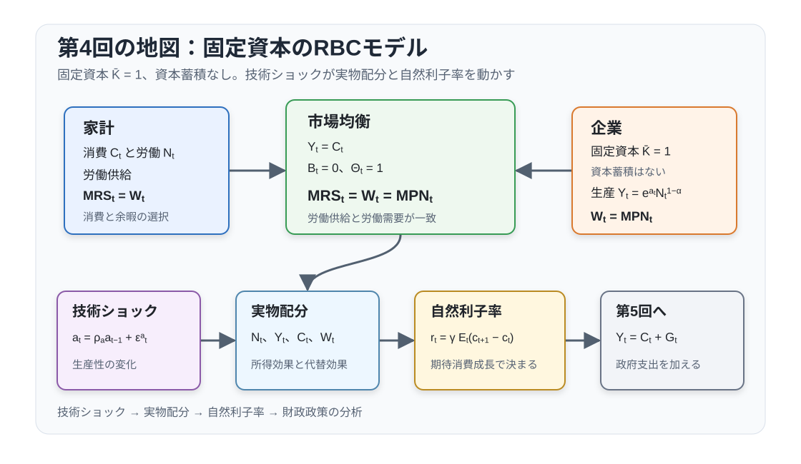

# 講義の目的

## 本講義で探究する中心的な問い

本講義では経済全体の資本ストック $\bar{K}$ を $1$ に固定（正規化）し、投資による資本蓄積を行わない最も基本的な「**柔軟価格（Flexible Price）モデル**」を構築・分析します。標準的なRBC（Real Business Cycle）モデルでは、投資を時点間で調整することが重要な役割を果たします。本モデルにはこの調整がないため、経済の動学はきわめて単純で見通しのよいものになります。外生的な技術ショック（生産性ショック）が観察された後、当期の家計の労働供給と企業の労働需要が相互に作用し、当期の実物配分（産出、消費、労働、実質賃金）が直ちに決定されます。

この経済の静学的配分を特徴づける中心的な均衡条件は、以下の2式に集約されます。
$$
MRS_t = W_t = MPN_t, \qquad Y_t = C_t.
$$

- 第1式は家計の主観的な限界代替率（MRS）、市場の実質賃金（$W_t$）、および企業の技術的な労働の限界生産力（MPN）が完全に一致するという労働市場の清算条件です。
- 第2式は投資も政府支出も存在しない閉鎖経済における財市場の需給均衡（資源制約式）です。

標準的な効用関数（CRRA効用・Frisch労働不効用）とCobb-Douglas生産関数を特定化すると、外生的な技術ショック $a_t$ に対する各マクロ変数の対数線形反応は、以下の明快な解析解として導かれます。
$$
\begin{aligned}
y_t &= \zeta_a a_t,\\
n_t &= \frac{1-\gamma}{\varphi+\alpha+\gamma(1-\alpha)} a_t,\\
r_t &= \gamma \zeta_a (\rho_a - 1) a_t.
\end{aligned}
$$
技術進歩に対して労働投入 $n_t$ が増加するか減少するかは、「賃金上昇に伴って働く誘因が高まる代替効果」と「富が増えて余暇を増やそうとする所得効果」の相対的な大小関係（パラメータ $\gamma \gtrless 1$）によって明確に決まります。また、実質利子率 $r_t$ は実物側で先に決まった消費経路を純供給ゼロの金融市場と整合させる「自然実質利子率（Natural Rate of Interest）」として受動的に定まります。

本講義の到達目標は以下の4点です。

1. 静学的均衡条件 $MRS_t = W_t = MPN_t$ および財市場清算を導出し、経済の実物配分を一意に決定する論理構造を理解する。
2. 技術ショックに対する産出、消費、労働、実質賃金の反応係数を導出してショック反応を解析し、代替効果と所得効果のメカニズムを説明できるようになる。
3. 実物側で決定された消費成長経路から、消費オイラー方程式を通じて自然実質利子率を導出できる。
4. 第5回で政府支出を導入してモデルを拡張する際、どの均衡条件がどのように修正されるかを明確に予見できるようにする。

@fig-lecture04-overview は家計と企業の静学的最適化条件から実物配分が決まり、自然実質利子率の導出へと進む理論の流れを図に整理したものです。

{#fig-lecture04-overview width=95% fig-pos="H"}

# 表記と基本設定

本講義ノートでは慣例に従い、変数の**水準値（Level）を大文字**で、定常状態からの**対数偏差（Log-deviation）を小文字**で表記します。たとえば、産出水準 $Y_t$ とその定常状態値 $Y$ に対し、対数偏差は $y_t \equiv \ln(Y_t / Y) \approx (Y_t - Y)/Y$ と定義されます。同様に、$c_t, n_t, w_t, r_t$ もそれぞれ消費、労働、実質賃金、総実質利子率の対数偏差を表します。

本ノートで使用する主要な変数の記号一覧は以下の通りです。

| 記号 | 経済学的意味 | 記号 | 経済学的意味 |
|---|---|---|---|
| $C_t$ | 実質消費水準 | $N_t$ | 労働投入量（就業時間） |
| $Y_t$ | 総産出水準（実質GDP） | $W_t$ | 実質賃金率 |
| $\bar{K}=1$ | 固定された実物資本ストック（$1$ に正規化） | $a_t$ | 技術水準（全要素生産性ショック）の対数値 |
| $B_t$ | 民間名目債券の実質購入額（期末の実質評価額） | $R_t$ | SDFから定義する比較基準の無リスク実質総利子率 |
| $\Theta_t$ | 企業の株式（持分）保有株数 | $V_t$ | 配当落ち後の企業株式時価総額（株価） |
| $D_t$ | 企業が支払う実質配当（企業利潤） | $R_t^N$ | 1期間名目総利子率（名目受取額は確定） |
| $P_t$ | 当期の物価水準 | | |
| $\Pi_t$ | 粗インフレ率（$P_t/P_{t-1}$） | $\mathbb{E}_t$ | 時点 $t$ の情報集合に基づく条件付き期待値演算子 |
| $B_t^N=P_tB_t$ | 名目債券の名目購入額 | $z_t$ | 技術・インフレなど、価格と将来の条件付き分布を要約する情報状態 |

家計の1期間の効用を $U(C_t,N_t)$ と表します。消費と労働に関する偏導関数を、それぞれ $U_{C,t}\equiv\partial U(C_t,N_t)/\partial C_t$、$U_{N,t}\equiv\partial U(C_t,N_t)/\partial N_t$ と書きます。

また、経済の構造を規定する基礎パラメータおよび頻出する派生パラメータは以下の通りです。異時点間消費代替弾力性をEIS（Elasticity of Intertemporal Substitution）、Frisch（フリッシュ）労働供給弾力性をFE（Frisch Elasticity）と略記します。両者の定義と導出は[構造パラメータの経済学的解釈](#sec-structural-parameters)で説明します。

| 記号 | 定義・経済学的意味 |
|---|---|
| $0 < \beta < 1$ | 家計の主観的割引因子 |
| $\gamma > 0$ | 相対的リスク回避度。異時点間消費代替弾力性（EIS）は $1/\gamma$ |
| $\varphi > 0$ | 労働の限界不効用の弾力性。Frisch労働供給弾力性（FE）は $1/\varphi$ |
| $0 \leq \alpha < 1$ | Cobb-Douglas型に特定化したときの固定資本の所得分配率（資本シェア） |
| $0 \leq \rho_a < 1$ | 技術ショックの自己相関（持続性）パラメータ |
| $MRS_t \equiv -U_{N,t}/U_{C,t}$ | 主観的限界代替率（消費財で評価した労働の限界不効用） |
| $MPN_t$ | 労働の限界生産力（第3.2節で定義式を示す） |
| $Q_{t,t+1} \equiv \beta U_{C,t+1}/U_{C,t}$ | 家計の限界効用に基づく確率的割引因子（SDF） |
| $\zeta_a \equiv \dfrac{1+\varphi}{\varphi+\alpha+\gamma(1-\alpha)}$ | 産出の技術ショックに対する反応弾力性係数 |

なお、経済全体における家計および企業の総測度（人口）、ならびに発行株式総数はすべて $1$ に正規化されています。したがって、1株あたりの株価 $V_t$ は企業全体の株式時価総額と完全に一致します。また、固定資本は企業が物理的に保有し、家計は企業の株式を保有することで、資本が生み出す収益を配当として間接的に受け取ります。

# 均衡条件

## 家計の最適化行動

各期 $t$ の期首に、まず外生的な技術ショック $a_t$ が実現し、観察されます。家計はその情報を踏まえて、当期の消費 $C_t$、労働供給 $N_t$、翌期への名目債券の実質購入額 $B_t$、および株式保有量 $\Theta_t$ を決定します。期首に前期から引き継ぐ資産残高 $B_{t-1}(h)$ および $\Theta_{t-1}(h)$ は所与の外生値です。

各家計は賃金、利子率、株価、配当を所与として選択します。経済全体の均衡では、家計と企業の最適化条件を各市場の清算条件と組み合わせ、これらの価格と配当も決定します。

すべての家計が同一の選好を持ち、初期保有資産が $B_{-1}(h)=0, \Theta_{-1}(h)=1$ で等しい「**代表的家計（対称均衡）**」を想定します。代表的家計 $h$ が解くべき動学的効用最大化問題は、以下の通りです。
$$
\max_{\{C_t(h), N_t(h), B_t(h), \Theta_t(h)\}_{t=0}^{\infty}} \mathbb{E}_0 \sum_{t=0}^{\infty} \beta^t U(C_t(h), N_t(h))
$$
本講義では、当期の名目購入額が $B_t^N$、翌期の名目受取額が $R_t^NB_t^N$ である1期間の名目債券を扱います。$R_t^N$ は時点 $t$ に確定します。名目購入額を当期の物価水準 $P_t$ で割った $B_t\equiv B_t^N/P_t$ を用い、予算制約を消費財単位で表示します。賃金 $W_t$、株価 $V_t$、配当 $D_t$ も実質値です。

各期における実質フロー予算制約式は次式で与えられます。
$$
\begin{aligned}
&C_t(h)+B_t(h)+\Theta_t(h)V_t\\
&=\frac{R_{t-1}^N}{\Pi_t}B_{t-1}(h)
 +\Theta_{t-1}(h)(V_t+D_t)\\
&\quad+W_tN_t(h).
\end{aligned}
$$
左辺は家計の当期総支出（消費、新規の債券購入、新規の株式購入）であり、右辺は利用可能な総実質資源（前期債券の元利合計、前期から持ち越した株式の売却評価額および受取配当、当期の労働所得）です。前期の名目債券の実質受取額は $R_{t-1}^NB_{t-1}^N/P_t=(R_{t-1}^N/\Pi_t)B_{t-1}$ です。名目受取額は前期に確定していますが、当期の実質受取額はインフレ率によって変わります。また、$V_t$ は配当落ち後の株価なので、前期から株式を保有する家計の資源には、当期の配当 $D_t$ と当期の株価 $V_t$ の両方が含まれます。

第3回と同じく、債券と株式を合わせた期末純金融資産の割引期待現在価値が、無限遠で負にならないというNo-Ponzi条件を課します。以下では消費と労働の選択が内点にあり、No-Ponzi条件を満たす継続経路を保ちながら、資産保有を増やす方向と減らす方向のどちらにも局所的に変更できる対称均衡を扱います。具体的な条件式、SDFの扱い、対称均衡での条件の確認は、末尾の[補論](#sec-asset-constraint-appendix)にまとめます。

### 価値関数とBellman方程式

ここからは家計の添字 $h$ を省略します。第3回の株式を含む家計問題と同じく、まず上の生涯効用最大化問題をBellman方程式で表し、そこから一階条件を導きます。第3回との違いは、家計が労働供給 $N_t$ を選んで賃金所得 $W_tN_t$ を得る点と、同回末尾で紹介した名目債券を取引する点です。

家計は価格・配当とその推移を所与として選択します。当期の技術水準 $a_t$ や粗インフレ率 $\Pi_t$ を含み、当期の賃金・名目利子率・株価・配当と、翌期以降の条件付き分布を要約する情報状態を $z_t$ とします。実物配分と名目変数がそれぞれどの条件から決まるかは、第7節で整理します。

家計が引き継ぐ状態は、前期の債券の実質購入額 $B_{t-1}$、その債券に適用される名目総利子率 $R_{t-1}^N$、前期の株式保有量 $\Theta_{t-1}$、および当期の情報状態 $z_t$ です。$B_{t-1}$ が同じでも、契約時の利子率 $R_{t-1}^N$ と当期に実現したインフレ率 $\Pi_t$ によって実質受取額が異なるため、これらを状態に含めます。

これらの状態から出発して得られる割引期待生涯効用の最大値を、価値関数 $J$ として
$$
\begin{aligned}
&J(B_{t-1},R_{t-1}^N,\Theta_{t-1},z_t)\\
&\quad\equiv
\max_{\{C_{t+i},N_{t+i},B_{t+i},\Theta_{t+i}\}_{i=0}^{\infty}}
\mathbb E_t\sum_{i=0}^{\infty}\beta^i U(C_{t+i},N_{t+i})
\end{aligned}
$$
と定義します。この最大化は各期の予算制約とNo-Ponzi条件を満たし、各時点で観察できる情報に基づいて選択する経路を対象とします。家計の価値関数 $J$ は効用単位で測られ、消費財単位で測る株価 $V_t$ とは異なります。

生涯効用を当期の効用と翌期以降の効用に分けると、当期に $B_t,\Theta_t$ を選んだ後の継続問題の最大値は、$J(B_t,R_t^N,\Theta_t,z_{t+1})$ です。したがって、元の最大化問題は次のBellman方程式として表せます。
$$
\begin{aligned}
&J(B_{t-1},R_{t-1}^N,\Theta_{t-1},z_t)\\
&\quad=\max_{C_t,N_t,B_t,\Theta_t}
\Bigl\{U(C_t,N_t)
+\beta\mathbb E_t[J(B_t,R_t^N,\Theta_t,z_{t+1})]\Bigr\}\\
&\text{制約：}\quad C_t+B_t+V_t\Theta_t\\
&\qquad\qquad=\frac{R_{t-1}^N}{\Pi_t}B_{t-1}+\Theta_{t-1}(V_t+D_t)\\
&\qquad\qquad\quad+W_tN_t.
\end{aligned}
$$
ここでも、No-Ponzi条件を満たす継続経路が選べる範囲で最大化します。翌期には新たな情報状態 $z_{t+1}$ が実現するため、継続価値の条件付き期待値を取ります。

### ラグランジュ関数と4つの一階条件

価値関数が微分可能であるとし、$U_{C,t}\equiv\partial U(C_t,N_t)/\partial C_t$、$U_{N,t}\equiv\partial U(C_t,N_t)/\partial N_t$ と書きます。前者は消費の限界効用、後者は労働を増やしたときの効用の変化であり、$U_{C,t}>0$、$U_{N,t}<0$ です。

第3回と同じく、当期の予算制約の資源残差（右辺から左辺を引いたもの）に、その期の効用単位で表した乗数 $\Lambda_t$ を付けます。ラグランジュ関数は
$$
\begin{aligned}
\mathcal L={}&U(C_t,N_t)
+\beta\mathbb E_t[J(B_t,R_t^N,\Theta_t,z_{t+1})]\\
&+\Lambda_t\Bigl[\frac{R_{t-1}^N}{\Pi_t}B_{t-1}+\Theta_{t-1}(V_t+D_t)\\
&\qquad\qquad+W_tN_t-C_t-B_t-V_t\Theta_t\Bigr]
\end{aligned}
$$
となります。家計は価格を所与として選択するため、操作変数 $C_t,N_t,B_t,\Theta_t$ について微分するとき、$W_t,R_t^N,V_t,D_t$ は固定します。4つの操作変数に関する内点の一階条件は次の通りです。
$$
\begin{aligned}
\frac{\partial\mathcal L}{\partial C_t}
&=U_{C,t}-\Lambda_t=0,\\
\frac{\partial\mathcal L}{\partial N_t}
&=U_{N,t}+\Lambda_tW_t=0,\\
\frac{\partial\mathcal L}{\partial B_t}
&=\beta\mathbb E_t[J_B(B_t,R_t^N,\Theta_t,z_{t+1})]-\Lambda_t=0,\\
\frac{\partial\mathcal L}{\partial\Theta_t}
&=\beta\mathbb E_t[J_{\Theta}(B_t,R_t^N,\Theta_t,z_{t+1})]
-\Lambda_tV_t=0.
\end{aligned}
$$
ここで $J_B$ と $J_{\Theta}$ は価値関数をそれぞれ債券保有額と株式保有量で偏微分したものです。他の状態変数は固定して微分します。

消費の条件から $\Lambda_t=U_{C,t}$ が得られます。したがって、乗数は当期の資源が1単位増えたときの効用価値を表します。労働を1単位増やすと、効用は $U_{N,t}$ だけ変化し、賃金所得が $W_t$ 増えます。労働の一階条件に $\Lambda_t=U_{C,t}$ を代入すると、
$$
U_{N,t}+U_{C,t}W_t=0
\quad\Longrightarrow\quad
W_t=-\frac{U_{N,t}}{U_{C,t}}
$$
という労働供給条件が得られます。

### 包絡線条件から債券・株式の価格条件へ

債券と株式の条件には翌期の価値関数の偏微分が残っています。これらを翌期の予算制約から求めます。翌期には、$B_t$ は実質元利金 $(R_t^N/\Pi_{t+1})B_t$ を、$\Theta_t$ は株式評価額と配当の合計 $\Theta_t(V_{t+1}+D_{t+1})$ をもたらします。包絡線定理により、翌期の最適な操作変数の変化による項は一階条件で消えるため、引き継いだ資産が翌期の資源を直接増やす効果だけを計算すればよく、
$$
\begin{aligned}
J_B(B_t,R_t^N,\Theta_t,z_{t+1})
&=\frac{R_t^N}{\Pi_{t+1}}\Lambda_{t+1},\\
J_{\Theta}(B_t,R_t^N,\Theta_t,z_{t+1})
&=(V_{t+1}+D_{t+1})\Lambda_{t+1}
\end{aligned}
$$
が得られます。債券の実質購入額で微分するときには、適用利子率 $R_t^N$ と翌期の情報状態 $z_{t+1}$ を固定します。翌期のインフレ率 $\Pi_{t+1}$ はその情報状態に含まれます。

これらの包絡線条件を債券と株式の一階条件に代入すると、
$$
\begin{aligned}
\Lambda_t&=\beta\mathbb E_t\left[\frac{R_t^N}{\Pi_{t+1}}\Lambda_{t+1}\right],\\
V_t\Lambda_t&=\beta\mathbb E_t[(V_{t+1}+D_{t+1})\Lambda_{t+1}]
\end{aligned}
$$
となります。さらに、各期の消費の一階条件 $\Lambda_t=U_{C,t}$ と $\Lambda_{t+1}=U_{C,t+1}$ を用いると、
$$
\begin{aligned}
U_{C,t}&=\beta\mathbb E_t\left[\frac{R_t^N}{\Pi_{t+1}}U_{C,t+1}\right],\\
V_tU_{C,t}&=\beta\mathbb E_t[(V_{t+1}+D_{t+1})U_{C,t+1}]
\end{aligned}
$$
が得られます。

```{=latex}
\Needspace{8\baselineskip}
```

当期の限界効用 $U_{C,t}>0$ は時点 $t$ で既知なので、両辺をこれで割り、第3回と同じ確率的割引因子（SDF）
$$
Q_{t,t+1} \equiv \beta \frac{U_{C,t+1}}{U_{C,t}}
$$
を用いて整理します。先ほどの労働供給条件と合わせると、家計の最適化から得られる一階条件（FOC）は以下の3式にまとめられます。
$$
\begin{aligned}
W_t &= -\frac{U_{N,t}}{U_{C,t}},\\
1 &= \mathbb{E}_t \left[ Q_{t,t+1} \frac{R_t^N}{\Pi_{t+1}} \right],\\
V_t &= \mathbb{E}_t \left[ Q_{t,t+1} (V_{t+1} + D_{t+1}) \right].
\end{aligned}
$$ {#eq-household-focs}

- 第1式は**静学的な労働供給条件**であり、労働を1単位増やすことの主観的限界不効用（消費単位換算：$-U_{N,t}/U_{C,t}$）と、労働の対価として得られる実質賃金 $W_t$ を一致させることを意味します。
- 第2式は**名目債券に関する消費オイラー方程式**であり、当期の限界効用と、名目債券の実質収益率を考慮した翌期の割引期待限界効用を結びつけます。
- 第3式は**株式の資産価格付け式**であり、当期の株価 $V_t$ が翌期の配当と配当落ち株価の和（$V_{t+1}+D_{t+1}$）を確率的割引因子 $Q_{t,t+1}$ で割り引いた期待現在価値と一致することを示しています。

名目総利子率 $R_t^N$ は当期に確定していますが、翌期のインフレ率は一般に不確実です。そのため、名目債券の事後的な実質収益率 $R_t^N/\Pi_{t+1}$ も不確実であり、第2式は $1=R_t^N\mathbb E_t[Q_{t,t+1}/\Pi_{t+1}]$ と書けます。第3式でも、翌期の株価と配当が不確実なので、SDFと翌期の受取額の積に期待値を取ります。なお、ここまでは個別家計の選択問題であり、市場清算条件 $B_t=0,\Theta_t=1$ はこの後に最適化条件と組み合わせます。

### 横断性条件と株式価値

さらに、第3回と同様に、期末の純金融資産に対して以下の横断性条件（TVC）を課します。
$$
\lim_{k \to \infty} \mathbb{E}_t \left[ Q_{t,t+k} \left( B_{t+k} + V_{t+k} \Theta_{t+k} \right) \right] = 0.
$$ {#eq-household-tvc}
ここで $Q_{t,t+k} \equiv \beta^k U_{C,t+k}/U_{C,t}$ は $k$ 期間にわたる確率的割引因子です。この条件は期末の純金融資産をSDFで割り引いた期待現在価値が、無限遠でゼロに収束することを要求します。限界効用で評価した、消費に使わない資産の価値を無限遠に残さないという条件です。資産水準そのもののゼロ収束や非発散とは区別します。

::: {.callout-note title="第3回との接続：株式価値"}
第3回の配当割引モデルと同様に、投機的バブルが存在しない「無バブル条件（Bubble-free Condition）」のもとでは、一階条件の第3式を前向きに逐次代入することにより、株式価値 $V_t$ は将来にわたる実質配当流列の割引現在価値の総和として一意に表現されます。
$$
V_t = \sum_{k=1}^{\infty} \mathbb{E}_t [Q_{t,t+k} D_{t+k}].
$$ {#eq-fundamental-equity-value}
本講義ではこのファンダメンタルズに基づく無バブル価格を株価として採用します。
:::

## 企業の利潤最大化行動

代表的な完全競争企業は所与の固定資本ストック $\bar{K} = 1$ と対数技術水準 $a_t$ のもとで、毎期の利潤を最大化するように労働投入量 $N_t$ を決定します。本モデルでは投資による資本蓄積がなく、資本レンタル市場も存在しないため、企業の意思決定には将来へ持ち越す状態変数がありません。したがって、企業の価値最大化問題は各期の静学的な利潤最大化問題に帰着します。

全要素生産性 $\exp(a_t)$ が $1$ のとき、資本投入量 $K$ と労働投入量 $N$ から得られる産出量を $F(K,N)$ と表します。技術水準 $\exp(a_t)$ と固定資本 $\bar K=1$ のもとで、企業の産出量および当期の実質利潤（実質配当）$D_t$ は次式で与えられます。
$$
Y_t = \exp(a_t) F(\bar{K},N_t) = \exp(a_t) F(1,N_t), \qquad D_t = Y_t - W_t N_t.
$$
完全競争のもとでプライス・テイカーとして行動する企業は、当期利潤 $D_t = \exp(a_t) F(1,N_t) - W_t N_t$ を労働投入量 $N_t$ に関して最大化します。資本を固定したときの労働に関する生産関数の1階と2階の偏導関数を、それぞれ $F_N(1,N_t)$ と $F_{NN}(1,N_t)$ と表します。$F$ は労働について2階微分可能で、正の労働投入量のもとで $F_N(1,N_t)>0$、$F_{NN}(1,N_t)\leq0$ と仮定します。すなわち、労働を増やすと生産は増えますが、その限界生産力は逓増しません。内点の一階条件は労働の限界生産力（$MPN_t$）を市場の実質賃金率 $W_t$ に等置することです。
$$
W_t = \exp(a_t) F_N(1,N_t) = MPN_t.
$$ {#eq-firm-conditions}
企業の利潤は産出額から賃金支払いを差し引いた残額であり、株主に配当として分配されます。

## 集計均衡と財市場清算

民間名目債券は家計間でのみ貸借される純供給ゼロの資産であり、企業の株式発行総数は $1$ に正規化されています。したがって、金融市場の清算条件は以下の通りです。
$$
\int_0^1 B_t(h)\,dh = 0, \qquad \int_0^1 \Theta_t(h)\,dh = 1.
$$
各家計のフロー予算制約式を経済全体で集計すると、純供給ゼロの名目債券項は実質受取額で評価しても相殺されて消滅し、株式の売買代金も相殺されます。その結果、集計された家計の総支出と総所得の関係は
$$
C_t = W_t N_t + D_t
$$
となります。ここに企業利潤の定義式 $D_t = Y_t - W_t N_t$ を代入すると、投資も政府支出も存在しない閉鎖経済における財市場の需給均衡条件（資源制約式）
$$
Y_t = C_t
$$
が直ちに導かれます。

対称均衡においては、すべての家計が同一の選択を行うため、各家計の保有量も $B_t = 0, \Theta_t = 1$ となります。

以上より、資本蓄積および政府部門が存在しない本モデルでは、各期の実物配分（$W_t, N_t, Y_t, C_t$）が満たす静学的均衡条件は、以下の4本の方程式にまとめられます。
$$
\begin{aligned}
W_t &= -\frac{U_{N,t}}{U_{C,t}},\\
W_t &= \exp(a_t) F_N(1,N_t),\\
Y_t &= \exp(a_t) F(1,N_t),\\
Y_t &= C_t.
\end{aligned}
$$ {#eq-static-equilibrium}

家計の労働供給条件と企業の労働需要条件を等置すると、実物配分の中心となる**労働市場の均衡条件**が得られます。
$$
MRS_t = W_t = MPN_t.
$$ {#eq-labor-market}
この中心的な関係式では、家計が追加的に1単位働くために求める主観的な消費補償（限界代替率 $MRS_t$）と、その労働が技術的に生み出す生産物（限界生産力 $MPN_t$）が、市場の実質賃金率 $W_t$ を通じて完全に一致します。所与の技術水準 $a_t$ のもとで、生産関数と資源制約式を労働市場の均衡条件に代入すれば、労働投入量 $N_t$ に関する方程式が得られます。その解から、産出量 $Y_t$、消費水準 $C_t$、実質賃金 $W_t$ を求めます。具体的な解とその一意性は次節で効用関数と生産関数を特定化したうえで確認します。

# 関数形と閉形式解

## 効用関数と生産技術の特定化

モデルの分析を具体的に進めるため、マクロ経済学において最も標準的に用いられる関数形を導入します。

家計の消費に関する期間効用関数 $u(C)$ として、**一定相対的リスク回避度（CRRA: Constant Relative Risk Aversion）効用関数**を採用します。
$$
u(C) =
\begin{cases}
\dfrac{C^{1-\gamma}-1}{1-\gamma}, & \gamma \neq 1,\\[8pt]
\ln C, & \gamma = 1.
\end{cases}
$$
各期の期間効用関数 $U(C_t, N_t)$ は消費による効用と労働による不効用が加法分離された次式で与えられます。
$$
U(C_t, N_t) = u(C_t) - \frac{N_t^{1+\varphi}}{1+\varphi}, \qquad \gamma > 0, \quad \varphi > 0.
$$
企業の一般的な生産関数 $F(\bar{K},N_t)$ を**Cobb-Douglas型** $F(\bar{K},N_t)=\bar{K}^\alpha N_t^{1-\alpha}$ に特定化します。固定資本 $\bar{K}=1$ のもとで、生産は次式で表されます。
$$
Y_t = \exp(a_t) \bar{K}^\alpha N_t^{1-\alpha} = \exp(a_t) N_t^{1-\alpha}, \qquad 0 \leq \alpha < 1.
$$
この関数形のもとでは、消費の限界効用 $U_{C,t}$、労働の限界効用 $U_{N,t}$、主観的限界代替率 $MRS_t$、および企業の労働限界生産力 $MPN_t$ は、それぞれ以下のように明示的に計算されます。
$$
\begin{aligned}
U_{C,t} &= C_t^{-\gamma},\\
U_{N,t} &= -N_t^\varphi,\\
MRS_t &\equiv -\frac{U_{N,t}}{U_{C,t}} = N_t^\varphi C_t^\gamma,\\
MPN_t &\equiv (1-\alpha) \exp(a_t) N_t^{-\alpha}.
\end{aligned}
$$
この特定化のもとで、企業の労働需要条件（@eq-firm-conditions）は $W_t=(1-\alpha)Y_t/N_t$ となります。したがって、総賃金支払い額と実質配当は
$$
W_tN_t=(1-\alpha)Y_t,\qquad D_t=Y_t-W_tN_t=\alpha Y_t
$$
と表されます。総産出 $Y_t$ のうち、$(1-\alpha)$ の割合は労働への報酬（労働所得）として支払われ、残る $\alpha$ の割合は固定資本の所有者である株主への実質配当（資本所得）として分配されます。

また、消費の限界効用に基づく確率的割引因子（SDF）は次式で表されます。
$$
Q_{t,t+1} = \beta \left( \frac{C_{t+1}}{C_t} \right)^{-\gamma}.
$$

## 均衡労働投入量の閉形式解

労働市場の均衡条件 $MRS_t = MPN_t$（@eq-labor-market）に具体的な関数形を代入すると、次式が得られます。
$$
N_t^\varphi C_t^\gamma = (1-\alpha) \exp(a_t) N_t^{-\alpha}.
$$
ここに財市場の清算条件 $C_t = Y_t = \exp(a_t) N_t^{1-\alpha}$ を代入して消費 $C_t$ を消去します。
$$
N_t^\varphi \left[ \exp(a_t) N_t^{1-\alpha} \right]^\gamma = (1-\alpha) \exp(a_t) N_t^{-\alpha}.
$$
左辺を展開して整理すると、
$$
N_t^{\varphi + \gamma(1-\alpha)} \exp(\gamma a_t) = (1-\alpha) \exp(a_t) N_t^{-\alpha}
$$
となり、$N_t$ の項を左辺に、技術ショック $a_t$ の項を右辺にまとめると、
$$
N_t^{\varphi + \alpha + \gamma(1-\alpha)} = (1-\alpha) \exp\left[ (1-\gamma) a_t \right]
$$
が導かれます。両辺の累乗根を取ると、外生的な技術水準 $a_t$ に対する均衡労働投入量 $N_t$ の**閉形式解（Closed-form Solution）**が一意に求まります。
$$
N_t = \left[ (1-\alpha) \exp\left\{ (1-\gamma) a_t \right\} \right]^{\frac{1}{\varphi + \alpha + \gamma(1-\alpha)}}.
$$ {#eq-labor-level}
この解析解を見ると、技術ショック $a_t$ が労働投入量 $N_t$ を増加させるか減少させるかは、指数部分の $(1-\gamma)$ の符号、すなわち相対的リスク回避度 $\gamma$ が $1$ より大きいか小さいかによって一意に決まることが分かります。

## 構造パラメータの経済学的解釈 {#sec-structural-parameters}

本モデルの動きを決める3つの主要な基礎パラメータ（$\gamma, \varphi, \alpha$）の経済学的意味は以下の通りです。

第一に、$\gamma$ は**相対的リスク回避度（Relative Risk Aversion）**を表します。**異時点間消費代替弾力性（EIS: Elasticity of Intertemporal Substitution）**は、異時点間限界代替率 $Q_{t,t+1}$ の変化に対する消費比 $C_{t+1}/C_t$ の弾力性として、
$$
\mathrm{EIS}\equiv-\frac{\partial\ln(C_{t+1}/C_t)}{\partial\ln Q_{t,t+1}}
$$
と定義します。本モデルのCRRA効用では、$Q_{t,t+1}=\beta(C_{t+1}/C_t)^{-\gamma}$ の対数を取ると、
$$
\ln Q_{t,t+1}=\ln\beta-\gamma\ln(C_{t+1}/C_t)
$$
です。$\beta$ を固定して消費比について解けば、定義式の微分より
$$
\mathrm{EIS}=-\left(-\frac{1}{\gamma}\right)=\frac{1}{\gamma}
$$
が得られます。負号は $Q_{t,t+1}$ と消費比が逆方向に変化する関係を、正の弾力性として表すためのものです。$\gamma$ が大きいほどEISは小さく、家計は異なる時点間の消費配分を変えにくくなります。確実性の下では、名目債券の条件から $Q_{t,t+1}=\Pi_{t+1}/R_t^N$ です。これは実質総利子率の逆数に等しいので、この定義は実質総利子率に対する消費比の弾力性としても解釈できます。

第二に、$\varphi$ は労働の限界不効用の弾力性を表します。**Frisch（フリッシュ）労働供給弾力性（FE: Frisch Elasticity）**は、消費の限界効用 $U_{C,t}$ を一定に保ったとき、当期の消費と労働の限界代替率 $MRS_t$ の変化に対して労働供給量 $N_t$ がどれだけ変化するかを表し、
$$
\mathrm{FE}\equiv
\left.\frac{\partial\ln N_t}{\partial\ln MRS_t}\right|_{U_C:\;\mathrm{const}}
$$
と定義します。本モデルでは $MRS_t=N_t^\varphi C_t^\gamma=N_t^\varphi/U_{C,t}$ なので、
$$
\ln MRS_t=\varphi\ln N_t-\ln U_{C,t}
$$
です。$U_{C,t}$ を固定して労働供給量について解けば、定義式の微分より
$$
\mathrm{FE}=\left.\frac{\partial\ln N_t}{\partial\ln MRS_t}\right|_{U_C:\;\mathrm{const}}
=\frac{1}{\varphi}
$$
が得られます。家計の労働供給条件では $MRS_t=W_t$ なので、消費の限界効用を一定に保ったもとでの実質賃金に対する労働供給の弾力性としても解釈できます。$\varphi$ が大きいほどFEは小さく、賃金が変化しても労働供給量は変わりにくくなります。

第三に、$\alpha$ は**資本分配率（Capital Share）**を表します。本モデルでは資本ストックが $\bar{K}=1$ に固定されているため、$\alpha$ は生産された総付加価値のうち、固定資本の所有者（株主）に実質配当として帰属する割合（$D_t = \alpha Y_t$）を決定します。残りの割合 $(1-\alpha)$ は労働者への実質賃金支払い（$W_t N_t = (1-\alpha) Y_t$）に充当されます。

# 定常状態

対数線形近似を行うための基準点として、確率的ショックが存在しない確定的な「**定常状態（Steady State）**」を求めます。外生的な技術ショックの定常水準を $a = 0$（すなわち $A = \exp(0) = 1$）と正規化します。定常状態では、すべての変数が時間を通じて一定の値（$C_t = C, N_t = N, Y_t = Y, W_t = W, D_t = D$）をとります。

## 水準値における定常状態の導出

定常状態における資源制約式、生産関数、企業の労働需要条件、および家計の労働供給条件は、それぞれ以下の通りです。
$$
\begin{aligned}
C &= Y = N^{1-\alpha},\\
W &= (1-\alpha) N^{-\alpha},\\
W &= N^\varphi C^\gamma.
\end{aligned}
$$
労働需要と労働供給を等置して実質賃金 $W$ を消去し、さらに $C = N^{1-\alpha}$ を代入すると、
$$
N^\varphi \left( N^{1-\alpha} \right)^\gamma = (1-\alpha) N^{-\alpha} \implies N^{\varphi + \alpha + \gamma(1-\alpha)} = 1 - \alpha
$$
が得られます。したがって、定常状態における各変数の水準値は以下のように一意に求まります。
$$
\begin{aligned}
N &= (1-\alpha)^{\frac{1}{\varphi + \alpha + \gamma(1-\alpha)}},\\
Y &= C = N^{1-\alpha} = (1-\alpha)^{\frac{1-\alpha}{\varphi + \alpha + \gamma(1-\alpha)}},\\
W &= (1-\alpha) N^{-\alpha} = (1-\alpha)^{\frac{\varphi + \gamma(1-\alpha)}{\varphi + \alpha + \gamma(1-\alpha)}},\\
D &= \alpha Y = \alpha (1-\alpha)^{\frac{1-\alpha}{\varphi + \alpha + \gamma(1-\alpha)}}.
\end{aligned}
$$
配当 $D = \alpha Y$ は固定資本 $\bar{K}=1$ に帰属する定常的な純収益を表しており、資本分配率 $\alpha > 0$ である限り常に正の値をとります。

固定資本を $1$ に正規化しても、一般に定常状態の変数値が $N = Y = C = W = 1$ に揃うわけではない点には注意が必要です。資本分配率 $\alpha > 0$ の場合、$1-\alpha < 1$ であるため、定常状態の労働投入量 $N$ は $1$ 未満となります。

唯一の例外は資本シェアが存在しない**線形生産関数（$\alpha = 0$）**のケースです。このとき $Y_t = \exp(a_t) N_t$ かつ $D_t = 0$ となり、定常状態（$a=0$）において
$$
N = 1, \qquad Y = C = 1, \qquad W = 1
$$
が厳密に成立します。「定常状態の値がすべて $1$ になる」という直観は、この極めて特殊な線形生産のケースに限られた性質であることに留意してください。

## 金融市場の定常状態

定常状態では消費水準が一定（$C_{t+1} = C_t = C$）なので、家計の限界効用に基づく確率的割引因子の定常値は、主観的割引因子に等しくなります。
$$
Q = \beta.
$$
インフレ率ゼロの確定的な定常状態 $\Pi=1$ を基準とします。名目債券のオイラー方程式（@eq-household-focs の第2式）に $Q=\beta$ と $\Pi=1$ を代入すると、定常状態の名目総利子率は
$$
R^N=\frac{1}{\beta}
$$
となります。第7節でSDFから定義する比較基準の無リスク実質総利子率も、定常状態では $R=1/\beta$ です。したがって、以下では $R^N=R=1/\beta$ を対数線形近似の基準に用います。

本講義ノートでこれ以降に使用する小文字の変数（$a_t, y_t, c_t, n_t, w_t, r_t$）は、すべてこれらの定常状態からの対数偏差（パーセント乖離）を表します。したがって、定常状態においてこれらはすべて $0$ となります。

# 対数線形解と技術ショックの動学分析

## 静学的均衡体系の対数線形化

第3節の一般形の静学的均衡体系（@eq-static-equilibrium）に、第4節で特定化した関数形を代入します。各式を定常状態の対応する式で割り、積とべき乗の対数を取ります。たとえば、労働需要式を定常式で割ると $W_t/W=\exp(a_t)(N_t/N)^{-\alpha}$ となり、対数を取れば下の第3式が得られます。他の式も同様に変換すると、以下の4本の線形方程式が得られます。これらはこの関数形と正の変数のもとで厳密に成立し、1次近似による誤差を含みません。
$$
\begin{aligned}
y_t &= a_t + (1-\alpha) n_t,\\
c_t &= y_t,\\
w_t &= a_t - \alpha n_t,\\
w_t &= \gamma c_t + \varphi n_t.
\end{aligned}
$$ {#eq-loglinear-system}

これら4式はそれぞれ直観的な経済学的解釈を持ちます。

1. 生産関数（第1式）：産出の対数偏差 $y_t$ は全要素生産性の向上 $a_t$ と、労働投入の増加 $(1-\alpha)n_t$ の和として決定されます。
2. 財市場清算（第2式）：投資や政府支出が存在しないため、産出のパーセント変動はそのまま消費のパーセント変動と一致します（$c_t = y_t$）。
3. 労働需要（第3式）：技術が $1\%$ 上昇すると、労働投入量を一定に保ったもとで企業の労働限界生産力（MPN）は $1\%$ 上昇します。一方、収穫逓減（$\alpha > 0$）のため、労働投入量が $1\%$ 増加するとMPNは $\alpha\%$ 低下します。
4. 労働供給（第4式）：パラメータ $\varphi$ は労働供給曲線の傾きを規定します。また、消費が $1\%$ 増加すると消費の限界効用が低下するため、家計は同じ労働を提供するためにより高い実質賃金を要求します。係数 $\gamma$ はこの消費増加に伴う「所得効果」の強さを表しています。

## 対数線形解の導出

連立方程式系（@eq-loglinear-system）を解くことで、技術ショック $a_t$ に対する各マクロ変数の反応を一意に導出できます。

まず、労働需要と労働供給の2式から実質賃金 $w_t$ を消去すると、
$$
a_t - \alpha n_t = \gamma c_t + \varphi n_t
$$
となります。ここに資源制約 $c_t = y_t = a_t + (1-\alpha)n_t$ を代入して消費 $c_t$ を消去すると、
$$
a_t - \alpha n_t = \gamma \left[ a_t + (1-\alpha)n_t \right] + \varphi n_t
$$
が得られます。$n_t$ の項を左辺に、$a_t$ の項を右辺に集めると、
$$
\left[ \varphi + \alpha + \gamma(1-\alpha) \right] n_t = (1-\gamma) a_t
$$
が導かれます。したがって、均衡労働投入量の対数偏差 $n_t$ は次のように求まります。
$$
n_t = \frac{1-\gamma}{\varphi + \alpha + \gamma(1-\alpha)} a_t.
$$

ここで、産出および消費の技術ショックに対する反応弾力性を表す係数 $\zeta_a$ を
$$
\zeta_a \equiv \frac{1+\varphi}{\varphi + \alpha + \gamma(1-\alpha)} > 0
$$
と定義します。このとき、産出 $y_t$ は生産関数 $y_t = a_t + (1-\alpha)n_t$ より、
$$
\begin{aligned}
y_t
&= a_t + (1-\alpha) \frac{1-\gamma}{\varphi + \alpha + \gamma(1-\alpha)} a_t \\
&= \frac{\varphi + \alpha + \gamma(1-\alpha) + (1-\alpha)(1-\gamma)}{\varphi + \alpha + \gamma(1-\alpha)} a_t \\
&= \zeta_a a_t.
\end{aligned}
$$
ときわめて簡潔に表せます。

同様に、実質賃金 $w_t$ は労働需要式 $w_t = a_t - \alpha n_t$ より、
$$
w_t = a_t - \alpha \frac{1-\gamma}{\varphi + \alpha + \gamma(1-\alpha)} a_t = \frac{\varphi + \gamma}{\varphi + \alpha + \gamma(1-\alpha)} a_t = \frac{1 - \alpha \zeta_a}{1-\alpha} a_t
$$
として導出されます。

以上をまとめると、対数線形化された均衡解は以下の明快な体系として得られます。
$$
\begin{aligned}
y_t &= \zeta_a a_t,\\
c_t &= y_t,\\
n_t &= \frac{1-\gamma}{\varphi + \alpha + \gamma(1-\alpha)} a_t = \frac{\zeta_a - 1}{1-\alpha} a_t,\\
w_t &= \frac{\varphi + \gamma}{\varphi + \alpha + \gamma(1-\alpha)} a_t = \frac{1-\alpha\zeta_a}{1-\alpha} a_t.
\end{aligned}
$$ {#eq-loglinear-solution}
分母の $\varphi + \alpha + \gamma(1-\alpha)$ は、労働供給の傾き（$\varphi$）、企業の収穫逓減度（$\alpha$）、および消費の限界効用低下を通じた所得効果（$\gamma(1-\alpha)$）の3要素を足し合わせた正の定数です。この分母が正であるため、所与の技術水準に対する静学的な均衡解は一意に定まります。ショックが時間とともに減衰する性質は、次節のAR(1)過程の係数 $0\leq\rho_a<1$ によって決まります。

## 技術ショックの動学とインパルス応答

外生的な技術ショック $a_t$ は以下の標準的な1階自己回帰過程（AR(1)過程）に従って推移すると仮定します。
$$
a_t = \rho_a a_{t-1} + \epsilon_t^a, \qquad 0 \leq \rho_a < 1, \qquad \mathbb{E}_{t-1}[\epsilon_t^a] = 0.
$$ {#eq-technology-process}
ここで $\rho_a$ は技術ショックの**持続性（Persistence）**を表すパラメータであり、$\epsilon_t^a$ は平均ゼロ、分散 $\sigma_a^2$ の白色雑音（White Noise）イノベーションです。

各期の期首には、前期末から持ち越した状態変数 $a_{t-1}$ が所与です。そこに新たな予期しないショック $\epsilon_t^a$ が加わり、当期の技術水準 $a_t$ が確定し、観察されます。家計と企業はこの $a_t$ を含む当期の情報集合に基づいて最適な消費・労働・生産を決定します。

時点 $t$ に経済が定常状態（$a_{t-1}=0$）にあるとき、大きさ $1\%$（$\epsilon_t^a = 0.01$）の技術ショックが発生し、その後のショックがゼロ（$\epsilon_{t+h}^a = 0, h \geq 1$）であったとします。このとき、$h$ 期間先の技術水準および各内生変数の**インパルス応答（Impulse Response Function: IRF）**は、以下のように指数関数的に減衰します。
$$
a_{t+h} = \rho_a^h \epsilon_t^a, \qquad x_{t+h} = \kappa_x \rho_a^h \epsilon_t^a \quad (x \in \{y, c, n, w\}).
$$ {#eq-technology-irf}
ここで各変数の反応係数 $\kappa_x$ は、対数線形解（@eq-loglinear-solution）から直ちに求まります。すなわち、
$$
\kappa_y = \zeta_a, \qquad \kappa_c = \zeta_a, \qquad \kappa_n = \frac{1-\gamma}{\varphi+\alpha+\gamma(1-\alpha)}, \qquad \kappa_w = \frac{\varphi+\gamma}{\varphi+\alpha+\gamma(1-\alpha)}
$$
となります。すべてのマクロ変数はショック発生期（$h=0$）に最も大きく反応し、その後は共通の減衰率 $\rho_a$ に従って滑らかに定常状態へ戻ります。

## 代替効果と所得効果の対立

対数線形解から得られる最も深い理論的洞察は、技術進歩が労働投入量 $n_t$ に与える影響の方向が、家計の選好パラメータ $\gamma$ の値によって決まるという点です。

技術水準 $a_t$ が向上すると、労働の限界生産力（MPN）が高まり、市場の実質賃金 $w_t$ が上昇します。この賃金上昇は家計に以下の2つの相反する効果をもたらします。

1. **代替効果（Substitution Effect）**：
   実質賃金の上昇は余暇の機会費用の上昇を意味します。したがって、余暇を減らして労働供給を増やそうとする誘因が働きます（労働投入に対する正の効果）。
2. **所得効果（Income Effect）**：
   賃金上昇および企業からの配当収入の増加は、家計の実質生涯富（購買力）を増大させます。余暇が正常財であるならば、豊かになった家計はより多くの余暇を消費しようとするため、労働供給を減らそうとする誘因が働きます（労働投入に対する負の効果）。

この2つの効果の相対的な強さは相対的リスク回避度（EISの逆数）$\gamma$ によって完全に決まります。

| $\gamma$ の領域 | 支配的な効果 | 労働投入 $n_t$ の反応 | 産出反応係数 $\zeta_a$ |
|---|---|---|---|
| $\gamma < 1$ | 代替効果が支配的 | 増加（$n_t > 0$） | $\zeta_a > 1$ |
| $\gamma = 1$ | 完全に相殺 | 不変（$n_t = 0$） | $\zeta_a = 1$ |
| $\gamma > 1$ | 所得効果が支配的 | 減少（$n_t < 0$） | $\zeta_a < 1$ |

: 正の技術ショックに対する反応の比較。 {#tbl-technology-response-signs tbl-colwidths="[16,28,30,26]"}

各ケースの経済学的直観は次の通りです。

- $\gamma<1$：賃金上昇による代替効果が所得効果を上回り、家計は就業時間を伸ばします。労働増加により産出は技術ショック以上に拡大します。
- $\gamma=1$：対数効用（$\ln C$）のもとでは代替効果と所得効果が相殺され、労働時間は技術ショックに対して変化しません。
- $\gamma>1$：家計は消費平準化の選好が強く、富の増加を余暇の拡大（労働の削減）へ振り向けます。労働減少のため産出の伸びは技術向上率を下回ります。

具体的な数値例として、標準的なパラメータ値（$\alpha = 0.4, \varphi = 1.0$）のもとで、$\gamma$ の違いによるインパクト反応係数を比較すると、以下のようになります。

| 相対的リスク回避度 $\gamma$ | 産出反応係数 $\kappa_y = \zeta_a$ | 労働反応係数 $\kappa_n$ | 賃金反応係数 $\kappa_w$ |
|---:|---:|---:|---:|
| $\gamma = 0.5$ | $1.176$ | $+0.294$ | $0.882$ |
| $\gamma = 1.0$ | $1.000$ | $0.000$ | $1.000$ |
| $\gamma = 2.0$ | $0.769$ | $-0.385$ | $1.154$ |

```{=latex}
\Needspace{12\baselineskip}
```

::: {.callout-important title="資本蓄積のないモデル特有の性質に関する注意"}
労働の反応が $(1-\gamma)$ の符号のみで決まり、後述のように正の一時的技術ショックに対して自然実質利子率が低下するという結果は、「投資による資本蓄積が存在しない」「消費と労働の効用が加法分離可能である」「財市場清算が常に $C_t = Y_t$ である」という本モデル固有の単純化に強く依存しています。

次学期以降に学ぶ資本蓄積を含む標準的なRBCモデルでは、技術向上に伴って投資需要が大きく増すため、たとえ $\gamma > 1$ であっても労働投入や実質金利が一時的に上昇するなど、より複雑で豊かな動学が現れます。
:::

# 自然実質利子率と古典派の二分法

## 実物配分の先行決定と金融市場

前章で確認した通り、実物配分（$n_t, y_t, c_t, w_t$）は、家計の労働供給、企業の労働需要、生産技術、および総資源制約の4条件のみから完全に先行して決定されます。

本講義で取引する名目債券は家計間で貸借される純供給ゼロの資産です。対称均衡では $B_t=0$ なので、名目利子率やインフレ率を含む債券項は集計予算から消え、財市場清算条件は $C_t=Y_t$ になります。したがって、実物配分は名目利子率やインフレ率を先に決めなくても求められます。

この消費経路からSDFを求め、時点間の資源配分と整合する実質利子率を復元します。そのうえで、名目債券のオイラー方程式を用いて、名目利子率と期待インフレ率の関係を導きます。

## 消費オイラー方程式と自然実質利子率の導出

家計のSDFから、比較基準となる無リスク実質総利子率を $R_t\equiv[\mathbb E_tQ_{t,t+1}]^{-1}$ と定義します。これは、翌期に確実に消費財を受け取る契約に対する家計の限界評価から求まる利子率です。本講義で取引する名目債券の事後的な実質収益率 $R_t^N/\Pi_{t+1}$ とは区別します。

この定義は $1=R_t\mathbb E_tQ_{t,t+1}$ と書けるので、CRRA効用のもとでは
$$
1 = \mathbb{E}_t \left[ \beta \left( \frac{C_{t+1}}{C_t} \right)^{-\gamma} R_t \right].
$$ {#eq-real-bond-euler}
$R_t$ は時点 $t$ において確定する1期間の無リスク実質総利子率であるため、期待値の外に取り出すことができ、
$$
R_t = \left\{ \mathbb{E}_t \left[ \beta \left( \frac{C_{t+1}}{C_t} \right)^{-\gamma} \right] \right\}^{-1}
$$
と表現されます。

比較基準の利子率を定義する条件（@eq-real-bond-euler）を定常状態（$R=1/\beta, C_{t+1}=C_t=C$）の周りで1次対数近似します。対数偏差を $r_t\equiv\ln(R_t/R)\approx(R_t-R)/R$、$c_t\equiv\ln(C_t/C)$ とすると、$\beta R=1$ より $1=\mathbb E_t[\exp\{r_t-\gamma(c_{t+1}-c_t)\}]$ です。第3回と同じく、期待値の中で $e^x\simeq1+x$ を用い、当期の $r_t,c_t$ が既知であることを使うと、以下の1次近似の関係が得られます。
$$
r_t = \gamma \mathbb{E}_t [c_{t+1} - c_t].
$$ {#eq-natural-rate-euler}
この方程式は、経済全体の期待消費成長率 $\mathbb{E}_t[c_{t+1} - c_t]$ が高いほど、当期の消費を抑えて翌期へ回すことに対して家計が求める実質収益率 $r_t$ が高くなることを示します。また、相対的リスク回避度 $\gamma$ が大きいほど（EIS $1/\gamma$ が小さいほど）消費を平準化しようとする動機が強くなるため、同じ期待消費成長率を支える利子率の変動幅は大きくなります。

ここで、外生ショック過程（@eq-technology-process）より $\mathbb{E}_t[a_{t+1}] = \rho_a a_t$ であり、また均衡消費が $c_t = \zeta_a a_t$ であることから、翌期の期待消費成長率は
$$
\mathbb{E}_t [c_{t+1} - c_t] = \zeta_a \mathbb{E}_t [a_{t+1} - a_t] = \zeta_a (\rho_a - 1) a_t
$$
と計算されます。これを実質利子率と期待消費成長率の関係（@eq-natural-rate-euler）に代入すると、伸縮価格の実物配分に対応する比較基準の実質利子率、すなわち「**自然実質利子率（Natural Rate of Interest: $r_t^f$）**」の解析解が得られます。上付きの $f$ は伸縮価格（flexible prices）を表し、後続回および演習解答でも同じ記号を用います。
$$
r_t^f = \gamma \zeta_a (\rho_a - 1) a_t.
$$ {#eq-natural-rate-technology}

ショックの持続性が $0 \leq \rho_a < 1$ であるとき、$(\rho_a - 1) < 0$ となります。したがって、正の一時的技術ショック（$a_t > 0$）が発生すると、自然実質利子率は必ず低下（$r_t^f < 0$）するという重要な結果が導かれます。

この現象を直観的に説明すると、正の技術ショックが発生した当期は生産性が高く、消費水準 $c_t$ が一時的に急上昇します。しかし、ショックは将来に向けて徐々に減衰するため、家計は「当期の消費水準に比べて、将来の消費水準は相対的に低くなる（負の消費成長率：$\mathbb{E}_t[\Delta c_{t+1}] < 0$）」と予想します。強い消費平準化動機を持つ家計は、豊かな当期の所得を将来のために貯蓄することを強く望みます。しかし、経済全体には貯蓄手段（資本蓄積）がなく、債券の純供給もゼロに固定されています。実現する消費経路は $C_t=Y_t$ のままです。この経路では、1次近似のもとで翌期の期待限界効用が当期の限界効用より高くなります。そのためSDFの条件付き期待値が上昇し、その逆数である比較基準の実質総利子率 $R_t$ は低下します。これが、自然実質利子率が低下するという結果の意味です。

ショックが恒久的（$\rho_a \to 1$）に近づくほど、当期の豊かさと将来の豊かさが等しくなるため、消費成長率の低下予想は弱まり、自然実質利子率の低下幅はゼロへと近づきます。

## フィッシャー方程式と古典派の二分法

実物サイドの方程式群は実質配分（$n_t, y_t, c_t, w_t$）および実質利子率 $r_t^f$ を完全に一意に決定します。しかし、名目変数である名目総利子率 $R_t^N$、粗インフレ率 $\Pi_{t+1} \equiv P_{t+1}/P_t$、および絶対物価水準 $P_t$ は、この実物ブロックからは一切決定されません。

第3節と同じ名目債券について、予算制約を名目表示で確認します。名目購入額は $B_t^N=P_tB_t$ であり、翌期の名目受取額は $R_t^NB_t^N$ です。第3節の実質表示の予算制約の両辺に $P_t$ を掛け、$\Pi_t=P_t/P_{t-1}$ を用いると、名目フロー予算制約は
$$
\begin{aligned}
P_tC_t+B_t^N+P_tV_t\Theta_t
={}&R_{t-1}^N B_{t-1}^N\\
&+P_t\Theta_{t-1}(V_t+D_t)+P_tW_tN_t
\end{aligned}
$$
です。左辺は名目の消費支出・債券購入・株式購入、右辺は前期債券の名目元利金・前期から保有する株式の名目評価額と配当・名目労働所得です。

第3節で実質表示の予算制約から導いた名目債券のオイラー方程式（@eq-household-focs の第2式）を再掲します。
$$
1 = \mathbb{E}_t \left[ Q_{t,t+1} \frac{R_t^N}{\Pi_{t+1}} \right].
$$ {#eq-nominal-bond-euler}
名目総利子率 $R_t^N$ は当期に確定しているため、債券を1通貨単位購入すれば翌期に $R_t^N$ 通貨単位を受け取れます。しかし、翌期のインフレ率が不確実なら、事後的な実質収益率 $R_t^N/\Pi_{t+1}$ も不確実です。前節でSDFから定義した比較基準の無リスク実質総利子率 $R_t$ と区別し、正確な資産価格条件ではSDFと実質収益率の積に期待値を取ります。

5.2節と同じく、インフレ率ゼロの確定的な定常状態 $\Pi=1$、$R^N=R=1/\beta$ を基準とし、$r_t^N\equiv\ln(R_t^N/R^N)$、$\pi_t\equiv\ln(\Pi_t/\Pi)=\ln\Pi_t$ と定義します。CRRA効用のもとでは $Q_{t,t+1}=\beta(C_{t+1}/C_t)^{-\gamma}$ なので、名目債券のオイラー方程式（@eq-nominal-bond-euler）は
$$
1=\mathbb E_t\left[
\exp\left\{r_t^N-\pi_{t+1}-\gamma(c_{t+1}-c_t)\right\}
\right]
$$
と書けます。期待値の中で $e^x\simeq1+x$ と近似し、当期の $r_t^N,c_t$ が既知であることを用いると、
$$
1\simeq1+r_t^N-\mathbb E_t\pi_{t+1}
-\gamma\mathbb E_t[c_{t+1}-c_t]
$$
です。したがって、1次近似のもとで
$$
r_t^N-\mathbb E_t\pi_{t+1}=\gamma\mathbb E_t[c_{t+1}-c_t]
$$
となります。右辺は比較基準の実質利子率 $r_t$（@eq-natural-rate-euler）に等しいので、**フィッシャー方程式**が得られます。
$$
r_t^N=r_t+\mathbb E_t\pi_{t+1}
$$ {#eq-fisher-equation}
名目利子率は実質利子率と期待インフレ率の和に等しくなります。同じ関係を $r_t=r_t^N-\mathbb E_t\pi_{t+1}$ と書けば、名目利子率から期待インフレ率を差し引くことで、事前的な実質利子率が得られます。ここでの利子率はいずれも総利子率の定常状態からの対数偏差です。

このフィッシャー方程式は確定的な定常状態の周りで得られる1次近似の関係です。分散・共分散による補正は2次以上に現れるため、この近似では省略されています。不確実性のもとで、$R_t=R_t^N/\mathbb E_t\Pi_{t+1}$ が厳密に成立するわけではありません。

本講義の伸縮価格均衡では $r_t=r_t^f$ なので、1次近似のもとで $r_t^N=r_t^f+\mathbb E_t\pi_{t+1}$ と書けます。実物側で決まる自然実質利子率と期待インフレ率に整合するように、名目利子率が定まります。

実質配分が名目変数（貨幣供給量や名目価格水準）の決定から完全に独立しているという性質を、マクロ経済学では「**古典派の二分法（Classical Dichotomy）**」と呼びます。

実物配分と名目体系を結びつけ、具体的なインフレ率や物価水準を一意に決定するためには、中央銀行の金融政策ルール（Taylorルールなど）や貨幣市場の均衡条件をモデルに追加する必要があります。

- 価格が完全に伸縮的な本モデルでは、均衡で成立する名目利子率と期待インフレ率の組合せは、1次近似のもとで $r_t^N-\mathbb E_t\pi_{t+1}=r_t^f$ を満たします。物価やインフレ率が調整されるため、名目側の変化は実物配分を変えません（貨幣の中立性）。
- 価格に硬直性が存在する場合（New Keynesianモデル：第7回以降）、企業の価格改定が遅れるため、古典派の二分法は成り立たなくなります。中央銀行が名目利子率を操作すると、1次近似のもとでの事前的実質利子率 $r_t^N-\mathbb E_t\pi_{t+1}$ が自然実質利子率 $r_t^f$ から乖離しえます。その差（実質金利ギャップ）は、産出量と自然産出量の乖離である「**需給ギャップ（産出ギャップ）**」に影響します。

# まとめと第5回への接続

本講義では固定資本を $1$ に正規化し、投資による資本蓄積を行わない最も純粋な柔軟価格RBCモデルを構築・分析しました。本講義の要点は以下の通りです。

1. 実物配分は一意に定まり、その核心は労働市場における主観的限界代替率と技術的限界生産力の一致条件 $MRS_t = W_t = MPN_t$（@eq-labor-market）にあります。
2. 技術ショックに対する産出、消費、実質賃金の反応は常に正ですが、労働投入量の反応方向は相対的リスク回避度 $\gamma \gtrless 1$（代替効果と所得効果の大小関係）によって決定されます。
3. 自然実質利子率 $r_t^f$ は実物側で先に決まった消費成長経路と整合するように、家計のSDFから定まる比較基準の実質利子率として求まります。一時的な正の技術ショックは、消費平準化の動機を通じて自然実質利子率を低下させます。

## 第5回への接続：政府支出の導入

次回の第5回講義では本モデルに政府部門（政府購入 $G_t$、一括税 $TX_t$ および一括移転 $TR_t$）を導入します。

総資源制約式は本講義の $Y_t = C_t$ から
$$
Y_t = C_t + G_t
$$
へと拡張されます。固定資本が蓄積できないという前提は維持されるため、政府支出の拡大は民間投資をクラウドアウトするのではなく、同一期内における家計の消費と労働供給の調整（負の富効果を通じた労働供給の増加）によって賄われます。

また、本講義の債券 $B_t$ は家計間で貸借される純供給ゼロの民間名目債券でした。第5回では政府が発行する国債が登場し、その純供給は政府債務残高に等しくなります。名目債券の実質表示には同じ $B_t$ を用いますが、純供給はゼロに固定されません。

第5回の一般化されたモデルで定常状態の政府支出比率をゼロ（$G/Y = 0$）とし、政府支出ショックをゼロと置けば、実物配分の解体系は本講義と一致します。ただし、この条件だけで国債残高や一括税・移転までゼロになるわけではありません。

# 参考文献

**基本文献**

- Galí, Jordi (2015) *Monetary Policy, Inflation, and the Business Cycle: An Introduction to the New Keynesian Framework and Its Applications* (2nd ed.). Princeton University Press. 第2章が資本蓄積のない柔軟価格モデルと自然実質利子率の最も標準的な参照先
- Romer, David (2019) *Advanced Macroeconomics* (5th ed.). McGraw-Hill. 実物ショックの伝播メカニズムと標準的な動学モデルの比較

**発展文献：資本蓄積を含む古典的RBCモデル**

- Kydland, Finn E., and Edward C. Prescott (1982) "Time to Build and Aggregate Fluctuations." *Econometrica*, 50(6), pp. 1345-1370.
- Hansen, Gary D. (1985) "Indivisible Labor and the Business Cycle." *Journal of Monetary Economics*, 16(3), pp. 309-327.
- King, Robert G., Charles I. Plosser, and Sergio T. Rebelo (1988) "Production, Growth and Business Cycles: I. The Basic Neoclassical Model." *Journal of Monetary Economics*, 21(2-3), pp. 195-232.
- King, Robert G., and Sergio T. Rebelo (1999) "Resuscitating Real Business Cycles." In John B. Taylor and Michael Woodford (eds.), *Handbook of Macroeconomics*, Vol. 1B, ch. 14, pp. 927-1007. Elsevier.
- Plosser, Charles I. (1989) "Understanding Real Business Cycles." *Journal of Economic Perspectives*, 3(3), pp. 51-77.

# 演習問題

## 基本問題

**問1 ［Core］：均衡概念の直観的理解**　資本蓄積のないRBCモデルにおいて、労働市場の均衡条件 $MRS_t = W_t = MPN_t$ が成立することの経済学的意味を、家計の最適化行動と企業の利潤最大化行動の双方の観点から平易な言葉で説明しなさい。

**問2 ［Core］［Derivation］：閉形式解の導出**　効用関数 $U(C_t, N_t) = \frac{C_t^{1-\gamma}-1}{1-\gamma} - \frac{N_t^{1+\varphi}}{1+\varphi}$、生産関数 $Y_t = \exp(a_t) \bar{K}^\alpha N_t^{1-\alpha}$（$\bar{K}=1$）、および財市場清算条件 $Y_t = C_t$ から、均衡労働投入量の水準値を与える閉形式解（@eq-labor-level）を途中の計算過程を含めて厳密に導出しなさい。

**問3 ［Core］：技術ショックの波及経路**　正の技術ショック（$a_t > 0$）が発生したとき、産出量、消費水準、および実質賃金がどのように変動するかを説明しなさい。また、労働投入量の反応の符号が相対的リスク回避度 $\gamma$ の値に依存する理由を、代替効果と所得効果の対立に触れて述べなさい。

**問4 ［Core］［Derivation］：固定資本と企業利潤**　企業の労働需要条件とCobb-Douglas生産関数から、総賃金支払い額が $W_t N_t = (1-\alpha) Y_t$、実質配当（利潤）が $D_t = \alpha Y_t$ となることを示しなさい。また、線形生産関数（$\alpha = 0$）の極限において、配当額および企業の株式価値がどのようになるかを論じなさい。

## 発展問題

**問5 ［Research extension］［Computation］：インパルス応答の具体的計算**　パラメータが $\alpha = 0.4, \varphi = 1.0, \gamma = 2.0, \rho_a = 0.9$ である経済を考えます。定常状態にある当期（$t$）に大きさ $1\%$（$0.01$）の正の技術ショックが発生し、その後のショックがゼロであったとします。このとき、技術水準 $a_{t+h}$、産出量 $y_{t+h}$、労働投入量 $n_{t+h}$、および実質賃金 $w_{t+h}$ のインパルス応答の値を、$h = 0, 1, 2$ についてそれぞれ計算しなさい。

**問6 ［Research extension］［Derivation］：自然実質利子率の導出と持続性**　比較基準の実質利子率と期待消費成長率の1次近似の関係 $r_t = \gamma \mathbb{E}_t [c_{t+1} - c_t]$ と均衡消費関数 $c_t = \zeta_a a_t$ から、自然実質利子率の決定式（@eq-natural-rate-technology）を導出しなさい。また、技術ショックの持続性パラメータ $\rho_a$ が $1$ に近づくにつれて、技術ショックに対する自然実質利子率の反応幅が小さくなる経済学的理由を直観的に説明しなさい。

```{=latex}
\begin{samepage}
```

**問7 ［Research extension］：第5回モデルへの拡張と構造比較**　政府支出を導入した総資源制約式 $Y_t = C_t + G_t$ を考えます。政府支出と総産出の定常状態値をそれぞれ $G$ と $Y$ とし、政府支出ショックを $g_t\equiv(G_t-G)/Y$ と定義します。定常状態の政府支出シェアをゼロ（$G/Y = 0$）、政府支出ショックをゼロ（$g_t = 0$）とした極限が、本講義の資源制約式 $Y_t = C_t$ と一致することを示しなさい。また、民間債券の純供給がゼロである本講義の金融市場と、正の純供給を持ちうる政府債務が存在する第5回の金融市場の違いが、家計の富やマクロ均衡にどのような相違をもたらすかについて論じなさい。

```{=latex}
\end{samepage}
```

```{=latex}
\clearpage
```

# 補論：No-Ponzi条件と内点均衡 {#sec-asset-constraint-appendix .unnumbered}

本編で課したNo-Ponzi条件と内点均衡の位置づけを確認します。No-Ponzi条件は家計が選べる資産経路を制限する実行可能性の条件です。横断性条件はその実行可能な経路のうち、最適経路が資産を使い残さないことを要求する条件です。

## No-Ponzi条件の定式化 {.unnumbered}

ここでの $B_t(h)=B_t^N(h)/P_t$ は、本文と同じ名目債券の期末の実質評価額です。市場の資産価格と整合的な正の1期間SDFを家計にとって所与とし、多期間SDFはその積
$$
Q_{t,t+k}\equiv\prod_{j=0}^{k-1}Q_{t+j,t+j+1}
$$
とします。実行可能性の判定では、比較するすべての消費・資産経路を同じSDFで評価します。以下の内点均衡では、本編の家計の限界効用比から得られるSDFをこの価格評価に用います。

本講義では、将来の純金融資産の割引期待現在価値が適切に定義され、有限の極限をもつ経路を対象とします。そのうえで、家計 $h$ のNo-Ponzi条件として
$$
\lim_{k\to\infty}\mathbb E_t\left[
Q_{t,t+k}\left(B_{t+k}(h)+V_{t+k}\Theta_{t+k}(h)\right)
\right]\geq0
$$ {#eq-household-no-ponzi}
を課します。この条件は各時点で実現した情報に条件づけて、ほとんど確実に成立することを要求します。極限が存在しない経路まで扱う一般形では、$\lim$ を $\liminf$ に置き換えます。

この非負の条件は実行可能性を制限するものであり、最適経路でゼロへの収束を要求する本編の横断性条件（@eq-household-tvc）とは役割が異なります。

## 対称均衡での確認 {.unnumbered}

第4節で特定化した生産関数のもとで、本編の対称均衡を確認します。家計間の対称性と市場清算から、各家計の保有量は次のようになります。
$$
B_t(h)=0,\qquad\Theta_t(h)=1
$$
配当は非負であり、本講義で採用する無バブル株価は、正のSDFによる配当の割引期待現在価値です。したがって、
$$
\begin{aligned}
D_t&=\alpha Y_t\geq0,\\
V_t&=\sum_{j=1}^{\infty}\mathbb E_t[Q_{t,t+j}D_{t+j}]\geq0
\end{aligned}
$$
となり、各家計の期末純金融資産は非負の株式価値に等しくなります。

さらに、上の配当の割引期待現在価値の総和が有限であると仮定します。SDFの積の性質と反復期待値を用いると、
$$
\begin{aligned}
&\mathbb E_t\left[Q_{t,t+k}\left(B_{t+k}(h)+V_{t+k}\Theta_{t+k}(h)\right)\right]\\
&\qquad=\mathbb E_t[Q_{t,t+k}V_{t+k}]\\
&\qquad=\sum_{j=k+1}^{\infty}\mathbb E_t[Q_{t,t+j}D_{t+j}]
\longrightarrow0\qquad(k\to\infty)
\end{aligned}
$$
です。右辺は収束する非負級数の残りの部分なのでゼロに収束します。したがって、この対称均衡では割引期待現在価値の有限な極限が存在し、No-Ponzi条件と横断性条件の双方が満たされます。

## 内点条件と一階条件 {.unnumbered}

一階条件の導出では、消費と労働の選択が内点であり、実行可能な範囲で債券・株式の保有量を両方向に局所的に変更できることを前提とします。有限期間だけ保有量を変更し、その後の保有量を元に戻す変更では、無限遠の資産経路は変わらず、No-Ponzi条件も維持されます。この内点の前提のもとで、本編の等式で表される一階条件を用います。
